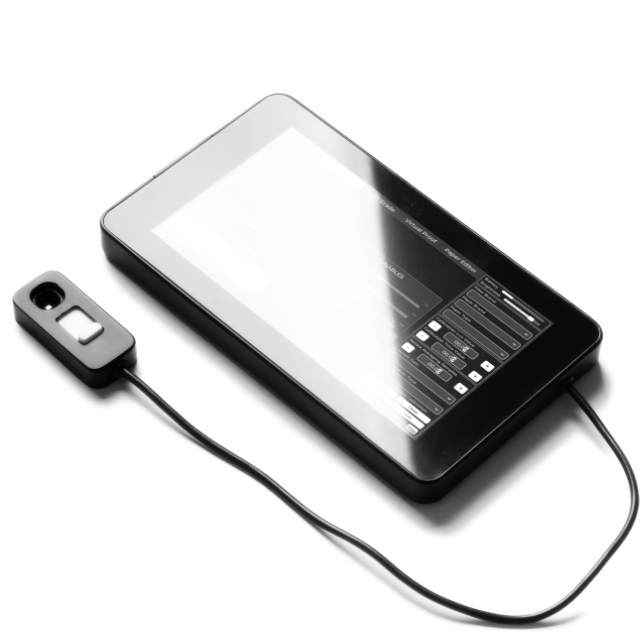

# SafelightIO — User Manual

**Digital darkroom exposure meter · Firmware 1.0 · Second edition, October 2026**

> [!IDEA] The one idea
> The meter measures the light on your easel and turns it into a printing time:
> **light × your paper's constant = seconds**. Every tool in the device is built on
> that one number. Once your paper is calibrated, any new light reading becomes a
> time immediately.

*Prototype hardware. The screen in this photo shows an early build; the labels in
this manual are the ones you will see on firmware 1.0.*

## How to use this manual

There are three ways in:

| If you want to… | Start at |
|---|---|
| Set the meter up and make a first print | **1. Start here** |
| Look up one control you can see on screen | **15. Reference → Index of controls** |
| Fix a problem | **13. Messages, Help Center and troubleshooting** |

The manual follows the device: first the screen, then the five tabs, then the
sidebar, then the jobs that need several steps (calibration, saving, updates).

**Words in this manual.** A **control** is something you tap, drag or type into.
A **readout** is a number or message the device shows you. Names printed in
**bold** match the labels on screen. The device is a small screen in a darkroom,
so labels are often abbreviated; the full name is given the first time.

> [!NOTE] The Help Center is on the device
> The **Help** button at the bottom of the sidebar opens the **Help Center**: seven
> short tabs (Start, Settings, Exposure, Contrast, Split Grade, Virtual Proof and
> Paper Editor), a QR code to the project page, and the support address shown on the
> Start tab (**support@cyanowood.com**). Use it when
> you are standing at the enlarger and need a reminder.
>
> The Help Center is a quick reminder. This manual is the complete, current
> reference. If a Help page and this manual disagree, trust this manual.

> [!TIP] Reading in the darkroom
> The HTML edition (open `MANUAL.html` in a browser) has a **Darkroom** button that
> switches to red-on-black. Use it on a phone or tablet beside the enlarger.

## Contents

1. **Start here** — what the meter does, the first session, the five tools
2. **The screen at a glance** — tabs, content area, sidebar, splash, confirmations
3. **Exposure** — measure the easel and get a time
4. **Contrast** — read the negative and choose a grade
5. **Split Grade** — two filters, two exposures, one print
6. **Virtual Proof** — preview the print, and check the enlarger's evenness
7. **Control Panel** — filter data, estimates, saving, sensor calibration
8. **Settings sidebar** — paper, sensor, brightness and battery
9. **Saving, loading and storage** — SD card, flash, backups, sessions
10. **Calibrating a paper** — the fifteen minutes that make the meter accurate
11. **The paper and filter database** — what is built in, and how to add your own
12. **Filter factors** — why a filter costs time, and how to measure yours
13. **Messages, Help Center and troubleshooting** — what the device is telling you
14. **Firmware updates** — updating safely, and what is kept
15. **Reference** — ranges, defaults, glossary, index, one-page cheat sheet

---

# 1. Start here

## 1.1 What the meter does

SafelightIO is a light meter for black-and-white enlarger printing. You put its
sensor where the print will be, press **Measure LUX**, and it tells you how many
seconds to expose the paper. It can also:

- recommend a **contrast filter grade** from two readings of the negative;
- work out a **split-grade** soft + hard exposure;
- paint a **preview grid** of the print from a series of readings;
- check that the enlarger's light is **even** across the easel.

It is not a densitometer and not a colour analyser. It measures the light that
actually falls on the easel, which is what the paper responds to.

## 1.2 The one thing that makes it accurate

The meter needs one number from you: how sensitive **your** paper is under **your**
enlarger. You find it once, with one test strip, and type the result into the
device. That is **paper calibration** (chapter 10). After that, every reading
becomes a time.

A meter that has not been calibrated for the selected paper cannot give a time. It
will show **`calibrate`** instead. This is normal, not an error.

## 1.3 What you need

- The meter, charged or plugged in.
- Your enlarger, focused at the height and aperture you will print at.
- A sheet of the paper you intend to use, for the calibration test strip.
- A darkroom (or a very dark room) for the sensor's dark calibration.
- Optional: a microSD card. It keeps settings, papers and sessions on removable
  storage and makes backups easy.

## 1.4 Your first session

| Step | What you do | Where | Time |
|---|---|---|---|
| 1 | Charge, power on, wait for the main screen | USB-C / power | 2 min |
| 2 | Choose **Paper Brand**, **Paper Type** and **Filter Brand** | Sidebar | 1 min |
| 3 | Calibrate the sensor: **Calibrate Dark**, then **Calibrate Light** | **Control Panel** tab | 10 min |
| 4 | Calibrate the paper with one test strip | Chapter 10 | 15 min |
| 5 | Measure the easel and print | **Exposure** tab | 1 min |

Steps 3 and 4 are one-time jobs per device/paper. You do not repeat them for every
print.

> [!IMPORTANT] Do the steps in this order
> The sensor calibration makes the lux numbers trustworthy. The paper calibration
> turns lux into seconds. Skipping the sensor step still gives a time, but it may be
> consistently too long or too short; skipping the paper step gives no time at all.

### Step 1 — Power on

Connect USB-C to charge if the battery is low. Press the power button; the splash
screen appears with a photography quote, a darkroom tip, the firmware banner
(**SafelightIO Darkroom Meter v.1.0**, **Prototype - Not for Sale**) and the serial
number. After a few seconds the main screen opens.

The backlight is deliberately dim while the device boots, then returns to your
saved brightness. If the screen looks almost black, see **Brightness** in chapter 8
before assuming the meter is broken.

### Step 2 — Choose the paper and filter

In the sidebar, set:

- **Filter Brand** — the brand of contrast filters in your enlarger (for example
  Ilford or FOMA). It changes the grade names and the built-in filter factors.
- **Paper Brand** and **Paper Type** — the paper in the easel.

Changing the paper reloads that paper's calibration and trims, and resets the
dodge/burn slider. Choose the paper before you measure, not after.

### Step 3 — Calibrate the sensor

Open the **Control Panel** tab and find **SENSOR CALIBRATION**:

1. **Calibrate Environment Noise** → **Calibrate Dark**, in total darkness.
2. **Calibrate Enlarger Light** → **Calibrate Light**, with the enlarger on and the
   sensor in steady light.

The full procedure, including the two-phase light calibration, is in section 7.4.
Do this once per device; repeat it if readings disagree between gain settings or
after a firmware update that changes the sensor settings.

### Step 4 — Calibrate the paper

Follow chapter 10. You will make one test strip, choose the correctly exposed
midtone, and enter its lux reading and time. The device computes the paper's
constant. From then on, the **Exposure** tab gives times for that paper.

### Step 5 — Measure and print

Open **Exposure**, choose the zone you measured (usually **V**), press **Measure
LUX**, and read the time. Chapter 3 explains every control on that tab.

## 1.5 The five tools at a glance

| Tab | Answers the question | Use it when |
|---|---|---|
| **Exposure** | “How long do I expose this print?” | You have a normal negative and want a time |
| **Contrast** | “Which grade does this negative need?” | The negative looks flat or contrasty |
| **Split Grade** | “What soft and hard exposures make this print?” | You want to control highlights and shadows separately |
| **Virtual Proof** | “What will the print look like across the easel?” | The negative is uneven, or you want to see before committing paper |
| **Control Panel** | “How is the meter set up?” | Filter data, paper estimates, saving, sensor calibration |

The **Enlarger mode** switch lives inside Virtual Proof; it turns the same grid into
a light-evenness test (section 6.5).

---

# 2. The screen at a glance

The annotated screen above names the three parts. Each tool chapter opens with its
own screenshot, so you can match the labels to the device.

The main screen has three parts:

- **Five tabs** across the top: Exposure, Contrast, Split Grade, Virtual Proof,
  Control Panel. The selected tab is highlighted.
- **The content area** in the middle: the controls and readouts for that tab.
- **The sidebar** on the right: paper, filter, sensor, calibration values,
  brightness, battery and the **Help** button. The sidebar is visible on every tab.

At the bottom of the sidebar the device shows **SafelightIO v.1.0**. This is the
firmware version; it is also on the splash screen and in the Help Center.

> [!NOTE] The screenshots are dim by design
> The device uses a dim red-on-black screen to protect your night vision. The
> screenshots in this manual reproduce that look; they can seem darker on paper than
> the screen does in a darkroom. They were taken before a reading, so values that have
> no measurement yet show `--`.

## 2.1 The tabs

| Tab | What it holds | Chapter |
|---|---|---|
| **Exposure** | Zone, lux, calibration constant, exposure time, filter grade and dodge/burn | 3 |
| **Contrast** | Highlight and shadow readings, contrast range, grade, trims | 4 |
| **Split Grade** | Soft and hard exposures, filter pair, trims | 5 |
| **Virtual Proof** | Grid, histogram, selected sample, stability, enlarger mode | 6 |
| **Control Panel** | **PAPER & FILTER EDITOR**, **ESTIMATE CALIBRATION**, **DATA MANAGER**, **SENSOR CALIBRATION** | 7 |

The fifth tab is labelled **Control Panel**. Its main heading is **PAPER & FILTER
EDITOR**. The Help Center calls the same area **Paper Editor**. They are the same
place; this manual uses **Control Panel** for the tab and **Paper & Filter Editor**
for the editing section.

## 2.2 The sidebar

The sidebar is the meter's setup panel. It stays put while you change tabs. The
full reference is chapter 8; in short:

- **Battery** and **Brightness** at the top.
- **Filter Brand**, **Paper Brand**, **Paper Type**.
- **Calibration Lux Value**, **Calibration Time Value**.
- **Sensor Averaging Samples**, **Sensor Gain**, **Intergration Time**.
- **SafelightIO v.1.0** and the **Help** button at the bottom.

> [!NOTE] The device spells one label “Intergration Time”
> The correct spelling is *Integration Time*. The manual uses the correct spelling
> in prose and quotes **Intergration Time** when it refers to the on-screen label,
> so you can find it on the device.

## 2.3 Common actions

| Action | What it does | Where |
|---|---|---|
| **Measure LUX** | Takes a light reading at the sensor | Exposure |
| **Measure Highlight** / **Measure Shadow** | Takes the two readings used for contrast | Contrast, Split Grade |
| **Measure** / **Measure next (n/total)** | Reads one proof cell and advances the grid cursor | Virtual Proof |
| **Set V Zone** / **Set Reference** | Uses the selected cell as the middle-gray anchor | Virtual Proof |
| **Clear Grid** | Erases the proof grid and its reference | Virtual Proof |
| **Reset** | Returns the current tab's trims to neutral (current paper only) | Contrast, Split Grade, Control Panel |
| **Help** | Opens the Help Center | Sidebar |

## 2.4 Confirmation screens

Some actions cannot be undone, so the device asks first. The screen asks
**Are you sure?** with **Yes** and **No**. It is used by:

- **Clear All Calibrations** (wipes every paper calibration and the reference);
- **Auto-Est. All Papers** (overwrites estimates for uncalibrated papers);
- **Load settings** and **Load Session** (replace current data);
- **Clear** under the sensor calibration headings;
- the second phase of **Calibrate Light**.

Read the question, then choose. **No** returns without changing anything.

## 2.5 The splash screen

At power-on, before the main screen:

- the banner **SafelightIO Darkroom Meter v.1.0**;
- **Prototype - Not for Sale**;
- an **Inspirational quote** and a practical darkroom tip (they change at random);
  for example **Tip: Pre-flash your paper for highlight detail**;
- a closing line such as **Have a happy developing sessions!**;
- the serial number and a QR code to the project page.

Nothing on the splash is a control. Wait for the main screen.

---

# 3. Exposure

**Use this tab when you have a negative and want a printing time.**

## 3.1 The screen

The left column is the measurement: zone, lux reading, calibration constant and the
**Measure LUX** button. The right column is the **FILTER & DODGE/BURN** panel:
filter grade transform, dodge/burn slider, additional time and total time.

The large number at the top is the **exposure time**. Before you measure it may show
a message instead of a number: **`calibrate`**, **`measure lux`**, **`no sensor`**
or **`error`**. Chapter 13 explains each one.

## 3.2 Every control and readout

| Element | What it is | What to do |
|---|---|---|
| **EXPOSURE CALCULATOR** | The tab heading | — |
| **Exposure time readout** | The suggested printing time in seconds | Read it; it updates after Measure and after filter/dodge changes |
| **SELECT ZONE OF MEASUREMENT** | Opens the zone list | Choose the zone you placed the sensor on; **V** is the normal midtone |
| **Zone of measurement** | The list: 0, I, II, III, IV, V, VI, VII, VIII, IX, X | See the zone table below |
| **LUX READING** | The last measured light level in lux | Shows the raw measurement |
| **CALIBRATION CONSTANT** | The paper's lux × seconds constant | Set by paper calibration; read-only here |
| **Measure LUX** | Takes a reading and calculates the time | Press once per measurement; the backlight dims while it reads |
| **FILTER & DODGE/BURN** | Heading for the right-hand panel | — |
| **FILTER GRADE TRANSFORM** | Opens the filter grade list | Choose the filter you will actually use. The grade's factor lengthens the time |
| **DODGE & BURN** | Heading for the slider and the two times | — |
| **Dodge and burn slider** | Adds or removes exposure in ¼-stop steps | Drag right to print darker, left to print lighter |
| **ADDITIONAL TIME** | The seconds added by the slider | Read-only; negative values mean less time |
| **TOTAL TIME** | Base time + additional time | This is the time to use at the enlarger |
| **F-Stop** | The slider's position expressed in f-stops | Read-only; useful when writing notes |

## 3.3 Step by step

1. **Select the paper.** In the sidebar choose **Paper Brand** and **Paper Type**.
2. **Select the filter.** Choose the grade you will put in the enlarger under
   **FILTER GRADE TRANSFORM**. “No filter” keeps the time unchanged.
3. **Place the sensor.** Put it where the midtone will fall on the easel. Keep your
   body and the safelight out of the light path.
4. **Choose the zone.** **V** for a midtone; **III** for a shadow you want to place;
   **VII** for a highlight.
5. **Press Measure LUX.** Wait for the backlight to return.
6. **Read the time.** Use **TOTAL TIME** if you moved the dodge/burn slider;
   otherwise use the large exposure time.

## 3.4 The zone list

The zone tells the meter which tone you measured. A reading at **Zone V** is the
reference. A reading at **Zone III** is two stops darker, so the meter multiplies
the light to find the equivalent Zone V value.

| Zone | Tone you are measuring | Meter factor |
|---|---|---|
| **0** | Deep black, almost no detail | ×32 |
| **I** | Black with a hint of detail | ×16 |
| **II** | Dark shadow with texture | ×8 |
| **III** | Shadow with good detail | ×4 |
| **IV** | Dark midtone | ×2 |
| **V** | Middle gray — the reference | ×1 |
| **VI** | Light midtone | ÷2 |
| **VII** | Highlight with texture | ÷4 |
| **VIII** | Bright highlight, little texture | ÷8 |
| **IX** | Near white | ÷16 |
| **X** | Paper white | ÷32 |

> [!TIP] Which zone should I use?
> Measure **V** when the sensor sits on the midtone. Measure **III** when you want
> to place a shadow, or **VII** for a highlight. The meter converts either reading
> to the same exposure scale, so you do not have to move the sensor to a midtone.

## 3.5 What the filter grade does

A contrast filter absorbs light, so it needs a longer exposure. The meter knows the
built-in factor for each grade and brand, and multiplies the base time by that
factor. The filter grade also changes the contrast of the print; the meter does not
try to compensate for that, because that is the point of the filter.

If you have measured your own filter factor (chapter 12), the device uses your value
instead of the built-in one.

## 3.6 Dodge and burn

The slider is a trim, not a second exposure. It adds or removes time from the whole
print in ¼-stop steps, up to ±2.25 stops. Use it when the print is consistently a
little light or dark, or when you want to try a variation without recalibrating.

- **ADDITIONAL TIME** shows the seconds the slider adds (or subtracts).
- **TOTAL TIME** is what you actually expose.
- The slider resets when you change paper.

For local dodging and burning under the enlarger, use the same total time as your
starting point and cover/uncover areas as usual.

## 3.7 A worked example

A portrait negative, Ilford FP4, printed on Ilford Multigrade Classic Cooltone.
The sensor is on the face at **Zone VI**.

1. The filter is grade **3**, factor about 2.5.
2. The sensor reads **2.84 lux** at Zone VI.
3. The meter converts Zone VI to the Zone V equivalent: 2.84 ÷ 2 = **1.42 lux**.
4. The paper's constant gives a base time of **8.80 s**.
5. The grade 3 factor makes it 8.80 × 2.5 ≈ **22 s**.
6. The dodge/burn slider at +2 quarter-stops adds about 10 s → **~32 s** total.

You do not have to do this arithmetic. The point is that every step has a visible
readout, and the **TOTAL TIME** already includes all of them.

## 3.8 Common questions

**Why does the time change when I change the filter?** The filter absorbs light; the
factor compensates. The print contrast changes too, which is why you chose the
filter.

**Why does the time change when I change paper?** Each paper has its own calibration
and its own trims.

**Can I use the meter without calibrating the paper?** You can read lux, but you
will not get a time. The tab shows `calibrate` until the paper is calibrated.

**The time looks wrong by exactly 2×.** Check that you measured the zone you think
you did, and that the enlarger height and aperture match the calibration. If they
do, run **Calibrate Light** again.

# 4. Contrast

**Use this tab when you want the meter to recommend a contrast grade.**

## 4.1 What the two readings mean

The meter needs two points in the projected image:

- **HIGHLIGHTS** — the **dim spot at easel**. A highlight on the print comes from a
  dense part of the negative, so less light reaches the easel.
- **SHADOWS** — the **bright spot at easel**. A shadow on the print comes from a
  clear part of the negative, so more light reaches the easel.

This is the part that surprises people. Measure the **dim** part for highlights and
the **bright** part for shadows. The small labels under the headings say exactly
that, so you do not have to remember.

## 4.2 Every control and readout

| Element | What it is | What to do |
|---|---|---|
| **CONTRAST CALCULATOR** | The tab heading | — |
| **HIGHLIGHTS** + **dim spot at easel** | The highlight reading area | Put the sensor on the dimmest important highlight and press **Measure Highlight** |
| **SHADOWS** + **bright spot at easel** | The shadow reading area | Put the sensor on the brightest important shadow and press **Measure Shadow** |
| **Highlight lux reading** | The light measured at the highlight | Read-only |
| **Shadow lux reading** | The light measured at the shadow | Read-only |
| **CONTRAST RANGE** | The brightness range of the negative in stops | Read-only; roughly 3 stops is gentle, 5 stops is contrasty |
| **CONTRAST GRADE** | The grade the meter recommends | The starting point for your filter choice |
| **Filter Grade** | The grade actually selected for the calculation | Shows the recommended grade; used for the time |
| **Match Quality** | How closely the negative fits that grade: **Exact**, **Close**, **Acceptable** or **Approximate** | **Exact**/**Close** need no action; **Acceptable** is a compromise; **Approximate** means the range falls between grades |
| **Analysis reasoning** | The explanation line under Match Quality | Read why the device chose the grade |
| **EXPOSURE TIME** | The suggested time at the midpoint | Read it |
| **Midpoint Time** | The time for the midtone | Read-only; the time before trims |
| **Midpoint LUX** | The light level of the midtone, derived from the two readings | Read-only |
| **Exposure Note** | A note about the result (for example, when the range is extreme) | Read it; it often explains a warning |
| **CALIBRATION CONSTANT** | The paper's lux × seconds constant | Read-only |
| **Measure Highlight** | Takes the highlight reading | Press once, with the sensor on the dim spot |
| **Measure Shadow** | Takes the shadow reading | Press once, with the sensor on the bright spot |
| **TUNABLES** | The four trim sliders | Use only when you want to override the recommendation |
| **Exposure** | Shifts the whole exposure up or down, ±1.5 stops in 1/6-stop steps | Adjust if the print is consistently light/dark |
| **Contrast** | Biases the grade softer or harder, ±1.5 stops | Adjust if the print needs more/less contrast than recommended |
| **Highlights** | Trims the highlight end, ±1.5 stops | Adjust if highlights print too light or too dark |
| **Shadows** | Trims the shadow end, ±1.5 stops | Adjust if shadows print too light or too dark |
| **Saved per paper** | Tells you the trims belong to the selected paper | Remember: changing paper loads that paper's own trims |
| **Reset** | Returns the four trims to neutral for the current paper | Use after experimenting |
| **DODGE & BURN** | A final whole-print trim | See below |
| **Additional time (Contrast)** | The seconds the dodge/burn slider adds | Read-only |
| **Total time (Contrast)** | The time to expose | Use this at the enlarger |
| **F-Stop** | The dodge/burn slider position in stops | Read-only |
| **Dodge and burn slider (Contrast)** | Adds/removes exposure in ¼-stop steps, ±2.25 stops | Drag right to darken, left to lighten |

## 4.3 Step by step

1. Select the paper in the sidebar.
2. Put the sensor on the **dimmest important highlight** and press **Measure
   Highlight**. Keep your body out of the light.
3. Put the sensor on the **brightest important shadow** and press **Measure
   Shadow**.
4. Read **CONTRAST RANGE**, **CONTRAST GRADE** and **Match Quality**.
5. Put the recommended grade in the enlarger. The **Filter Grade** readout already
   includes that grade's exposure factor.
6. Read **EXPOSURE TIME** (or **Total time** if you use the dodge/burn slider).
7. If the print is consistently off, use the **TUNABLES** and the **Reset** button.

> [!TIP] If you only have one reading
> Both readings are required. With one missing, the tab shows `--` and the reason
> is given in the note. Measure the missing point and the result appears
> immediately.

## 4.4 How the recommendation works, without the maths

The two readings give a **brightness range**. A negative with a small range is
flat and needs a harder grade; a negative with a large range is contrasty and needs
a softer grade. The meter compares the range with the paper's contrast data and
picks the closest grade.

- **CONTRAST RANGE** is in stops of exposure.
- **CONTRAST GRADE** is the recommended filter grade.
- The **time** is taken from the middle of the two readings, so the midtone stays
  put when you change grade.
- **Match Quality** tells you how well the negative fits the paper's range.
- The **trims** let you move the result without recalibrating.

## 4.5 Fixed-grade papers

Some papers have one fixed contrast grade. For those papers the tab shows **Fixed
grade** and:

- the trims are ignored;
- **Split Grade** is not applicable;
- in the **Control Panel**, the Factor and ISO R fields are disabled; only ISO P
  can be changed.

The eight fixed-grade papers are listed in chapter 11.2. If you are printing on one,
use **Exposure** and choose the filter grade that matches the paper's grade.

## 4.6 A worked example

A landscape negative on Ilford Multigrade RC Deluxe:

- highlight reading **4.10 lux**;
- shadow reading **0.32 lux**;
- the range is about **3.7 stops**;
- the meter recommends grade **1** with **Close** match;
- **EXPOSURE TIME** is **14.2 s**.

A grade 1 filter is soft, which suits the contrasty negative. If the print's
highlights are too bright, add a small **Highlights** trim; if the shadows are
muddy, add a **Shadows** trim.

## 4.7 Common questions

**The grade changes when I move one reading slightly.** Small changes near a grade
boundary can flip the recommendation. Look at **Match Quality**; **Close** means
either neighbouring grade is reasonable.

**The time is not what I expected.** The time is for the midpoint, not for the
highlight. That is deliberate: it keeps the midtone stable when you change grade.

**Should I use Contrast or Split Grade?** Use Contrast when one grade suits the
whole print. Use Split Grade when the shadows and highlights need different filters.

---

# 5. Split Grade

**Use this tab when shadows and highlights need different contrast.**

## 5.1 The idea

Split-grade printing gives the print two exposures through two filters:

- a **soft** filter for the highlights and midtones;
- a **hard** filter for the shadows and blacks.

The meter measures the same two points as the Contrast tab, then works out how much
of the total exposure each leg should carry. The result is a pair of times that add
up to the print you want.

## 5.2 Every control and readout

| Element | What it is | What to do |
|---|---|---|
| **SPLIT GRADE CALCULATOR** | The tab heading | — |
| **HIGHLIGHTS** + **dim spot at easel** | Highlight measurement area | Measure the dim part of the image |
| **SHADOWS** + **bright spot at easel** | Shadow measurement area | Measure the bright part |
| **Split highlight lux reading** | Highlight light level | Read-only |
| **Split shadow lux reading** | Shadow light level | Read-only |
| **CONTRAST RANGE** | The negative's range in stops | Read-only |
| **Equivalent grade readout** | The single grade that would be closest to this split | Useful as a sanity check |
| **SOFT EXPOSURE** | The soft leg's filter name and time | Use this filter for the soft exposure |
| **Soft filter name** | The soft filter chosen by the meter | Changes with **Midtones** and paper |
| **Soft exposure time** | Seconds for the soft leg | Read-only |
| **HARD EXPOSURE** | The hard leg's filter name and time | Use this filter for the hard exposure |
| **Hard filter name** | The hard filter chosen by the meter | Changes with **Midtones** and paper |
| **Hard exposure time** | Seconds for the hard leg | Read-only |
| **TOTAL EXPOSURE TIME** | Soft + hard time | The total time the paper receives |
| **CALIBRATION CONSTANT** | The paper's constant | Read-only |
| **ANALYSIS DETAILS** | The reasoning: percentages of soft/hard light, and any warnings | Read it before printing |
| **Measure Highlight** / **Measure Shadow** | Take the two readings | Same as Contrast |
| **TUNABLES** | Five trims | Use after the first test print |
| **Exposure** | Shifts the total exposure, ±1.5 stops in 1/6-stop steps | Lighten/darken the whole print |
| **Contrast** | Biases the overall contrast, ±1.5 stops | More/less separation |
| **Highlights** | Trims the soft leg, ±1.5 stops | Adjust highlight density |
| **Midtones** | Chooses the split pair, ±1.5 stops | Moves the balance between soft and hard filters |
| **Shadows** | Trims the hard leg, ±1.5 stops | Adjust shadow density |
| **Saved per paper** | The trims belong to the selected paper | Changing paper loads its own trims |
| **Reset** | Returns all five trims to neutral | Use after experimenting |
| **DODGE & BURN** | Adds a final whole-print trim to both legs | See below |
| **Additional soft time** | Seconds added to the soft leg | Read-only |
| **Total soft time** | Soft leg after the trim | Use this at the enlarger |
| **Additional hard time** | Seconds added to the hard leg | Read-only |
| **Total hard time** | Hard leg after the trim | Use this at the enlarger |
| **F-Stop** | Dodge/burn slider position | Read-only |
| **Dodge and burn slider (Split Grade)** | Adds/removes exposure, ±2.25 stops | Drag right to darken, left to lighten |

## 5.3 Step by step

1. Select the paper and filter brand.
2. Measure the dim highlight and the bright shadow, as in chapter 3.
3. Read the **SOFT EXPOSURE** and **HARD EXPOSURE** names and times.
4. Expose the print: soft leg first, then hard leg (or the reverse, if your workflow
   prefers; the total light is the same).
5. If the print needs adjustment, use the trims, then **Reset** to start again.
6. Use **DODGE & BURN** only for a final whole-print shift; it scales both legs.

> [!WARNING] Watch the analysis details
> The meter may warn that **highlights may burn** or that contrast is **limited**.
> Those warnings mean the requested split is outside what the paper can hold. Choose
> a less extreme **Midtones** position, or change the negative.

## 5.4 How the split is chosen, without the maths

The meter decides what share of the light each leg should carry. At one extreme the
print is almost all soft; at the other, almost all hard. The **Midtones** slider
moves that balance. The meter keeps the midtone anchored, so changing the balance
does not make the whole print lighter or darker; it changes how the shadows and
highlights separate.

The **Highlights** and **Shadows** trims adjust the two ends independently. The
**Exposure** and **Contrast** trims adjust the whole print.

## 5.5 A worked example

A portrait negative:

- highlight **8.00 lux**;
- shadow **0.12 lux**;
- the range is about **6.1 stops**;
- the equivalent grade is **00**;
- soft leg: grade **00**, **29.5 s**;
- hard leg: grade **5**, **6.9 s**;
- total **36.4 s**.

The soft leg carries most of the light (about 89%) because the negative is very
contrasty. If the highlights are still too dense, add a **Highlights** trim; if the
shadows lose detail, add a **Shadows** trim.

## 5.6 Common questions

**Why are there two times?** The paper receives both exposures. The total is their
sum; the split decides where the contrast goes.

**Which leg first?** It does not matter for the total exposure. Many printers do
soft first, then hard; choose one order and keep it for consistency.

**The soft and hard filters look odd.** The names follow the selected **Filter
Brand**; for FOMA papers a “Special” grade may appear as one of the legs. That is
normal.

**Can I use Split Grade on a fixed-grade paper?** No. The tab will tell you it is
not applicable. Use **Exposure**.

---

# 6. Virtual Proof

**Use this tab when you want to see how the print will look across the easel before
you commit a sheet.**

## 6.1 What it does

The grid divides the easel into cells. You measure each cell; the device paints each
cell with the gray it expects on the print at the selected paper and grade. The
result is a low-resolution preview of the print, plus a histogram of the tones.

It is a proof, not a scanner: the preview is only as good as the cells you measured.

## 6.2 Every control and readout

| Element | What it is | What to do |
|---|---|---|
| **Grid Size** | Sets the grid's width and height | Choose 3–5 cells per side for a quick proof; more cells for a detailed one |
| **Grid width** | Cells across, 2–40 | Changing the size clears the grid |
| **Grid height** | Cells down, 2–30 | Changing the size clears the grid |
| **Measure** | Reads the next cell | Press once per cell; the button becomes **Measure next (n/total)** during a scan |
| **Set V Zone** | Makes the selected cell the Zone V reference | Use it when you know which cell is the middle gray |
| **Clear Grid** | Erases all cells, the selection and the reference | Start a new proof |
| **Grid canvas** | The painted preview | Tap a cell to select it |
| **HISTOGRAM** | Distribution of the predicted gray values | Read the shape: left is shadow, right is highlight |
| **SELECTED SAMPLE** | The readouts for the selected cell | Tap a cell to inspect it |
| **Lux (selected sample)** | The measured light in that cell | Read-only |
| **Zone (selected sample)** | The predicted zone of that cell | Read-only |
| **ISO R (selected sample)** | The contrast range of the paper at this grade | Read-only |
| **EV Range (selected sample)** | The exposure range represented by the cell | Read-only |
| **Density (selected sample)** | The predicted print density | Read-only |
| **Exposure (selected sample)** | The exposure time for that cell | Read-only |
| **Clipping (selected sample)** | Whether the cell falls off the paper's range | If it clips, choose a different grade or split |
| **SETTINGS** | The proof's options | — |
| **Filter grade selector (Virtual Proof)** | The grade used to render the preview | Change it to see a different grade; the grid re-renders |
| **Enlarger Mode switch** | Turns the proof into a light-evenness test (section 6.5) | Use it with no negative in the carrier |
| **Uniformity Limit** | The allowed brightness variation in Enlarger mode, 5–50% (default 15%) | Set it to what your printing requires |
| **Stability Detection switch** | Turns on automatic settling during a scan | Use it for hands-free scans |
| **Tolerance (%)** | How close two reads must be to count as stable | Smaller is stricter |
| **Min Stable Reads** | How many stable reads are required | More is stricter |
| **Max Wait (ms)** | The longest the meter waits for a cell to settle | Prevents a scan from stalling |
| **Min Delta (lux)** | A floor for very dim cells | Stops noise from looking like change |

> [!NOTE] The stability fields
> The four stability fields are used when **Stability Detection** is on. With it
> off, each press of **Measure** records a single reading immediately.

> [!NOTE] The first reference is chosen for you
> When an automatic scan finishes, the meter picks a provisional Zone V
> reference: the cell nearest the middle of the measured brightness range in
> exposure terms. It is a starting point, not a guarantee that the cell is your
> middle gray. Select the cell you trust and press **Set V Zone** to take over.
> A manual, one-cell-at-a-time proof does not set a reference automatically.

## 6.3 The grid frames

The frame colour tells you what a cell is:

| Frame | Meaning |
|---|---|
| **Amber** | The next cell the meter will read |
| **Red** | The cell you selected |
| **Cyan** | The Zone V reference cell |
| **Light gray** | Highlight clipping — the cell is too bright for the paper |
| **Dark gray** | Shadow clipping — the cell is too dark for the paper |
| **No frame** | An ordinary measured cell |

Colour is a shortcut, not the only cue: the selected sample readouts and the
histogram tell you the same story in numbers.

## 6.4 A proof in ten steps

1. Set **Grid Size** to a small grid, for example 4 × 3.
2. Choose the **Filter grade** you intend to print.
3. Press **Measure** for the first cell and place the sensor in the highlighted
   cell.
4. Keep pressing **Measure** (or turn on **Stability Detection** and let the meter
   scan) until the grid is filled.
5. Read the **HISTOGRAM**. A shape crowded on the right means the print will be
   bright; crowded on the left means dark.
6. Tap a cell to see its **SELECTED SAMPLE** readouts.
7. If you know the middle gray, select that cell and press **Set V Zone**.
8. Change the grade and watch the grid re-render.
9. **Clear Grid** to start again; changing **Grid Size** also clears it.
10. Save the session if the proof is worth keeping (chapter 9).

> [!TIP] A quick proof is better than no proof
> Six cells tell you whether the print is basically even. You do not need a
> 40 × 30 grid to catch a hot corner or a vignette.

## 6.5 Enlarger mode — is the light even?

Enlarger mode uses the same grid, but there is **no negative in the carrier**. The
grid becomes a map of the bare enlarger light.

**Set up:**

1. Remove the negative. Leave the carrier empty.
2. Set the lens to the aperture and the head to the height you will print at.
3. Let the lamp warm up.
4. Put an opal diffuser over the sensor if you have one; do not let the meter shadow
   the point you are measuring.
5. Turn **Enlarger Mode** on. The filter grade selector is not used in this mode.
6. Set **Grid Size** to 3 × 3 (nine points) or 5 × 5 for a finer map.
7. Press **Measure** for each point, or turn on **Stability Detection** and scan.
8. Select the centre cell and press **Set Reference**. The centre is the reference
   for the deviation readouts.

**The readouts:**

| Readout | Meaning |
|---|---|
| **Lux** | The light at the selected point |
| **Dev %** | How far the point deviates from the reference, in percent |
| **Dev EV** | The same deviation in stops |
| **Range** | The spread between the brightest and dimmest points |
| **Mean** | The average of all measured points |
| **Min–Max** | The dimmest and brightest points |
| **Verdict** | **GOOD**, **MARGINAL** or **UNEVEN** |

**The verdict:**

- **GOOD** — every point is within half the **Uniformity Limit**.
- **MARGINAL** — the worst point is between half the limit and the full limit.
- **UNEVEN** — the worst point is beyond the limit.

The default limit is **15%**, which is roughly 0.2 stop. That is a reasonable
working tolerance for most enlargers and papers. A stricter limit (for example 10%)
is useful for critical work; a looser one (25–30%) may be acceptable for rough
proofs.

**What the map tells you:**

- dark corners — condenser or diffuser misalignment, or a lens that does not cover
  the format;
- a bright centre with dark edges — normal falloff for a condenser enlarger, worse
  at large magnification;
- an off-centre hot spot — the lamp is not centred;
- a single dark cell — something is shadowing that point (your hand, the meter, a
  cable).

Enlarger mode measurements are kept when you switch back to negative mode, so you
can inspect them later. Saving the session stores the mode and the grid
(chapter 9).

# 7. Control Panel

**Use this tab to edit filter data, estimate calibrations, save/load, and calibrate
the sensor.**

The tab is labelled **Control Panel**. Its main heading is **PAPER & FILTER
EDITOR**. The Help Center calls the same area **Paper Editor**. The tab has four
sections in two columns:

- **PAPER & FILTER EDITOR** — left column, top. Override the built-in factors and
  ISO values.
- **ESTIMATE CALIBRATION** — left column, bottom. Copy a calibration to other
  papers by speed.
- **DATA MANAGER** — right column, top. Save and load settings and sessions.
- **SENSOR CALIBRATION** — right column, bottom. Dark and light calibration.

## 7.1 Paper & Filter Editor

This section changes the numbers the meter uses for a **paper + filter grade**
combination. It is for advanced users; the built-in data is good enough for most
printing. Edits are saved in flash and survive a power cycle.

| Element | What it is | What to do |
|---|---|---|
| **Select Filter** | Chooses the grade to edit | Pick the grade whose data you want to change |
| **Lengthening Factor** | The filter's exposure multiplier | Raise it if prints through that filter are too light; lower it if too dark |
| **ISO R Range** | The contrast range this grade produces | Higher = softer contrast; lower = harder |
| **Base ISO P** | The paper's unfiltered speed | Higher = shorter times; lower = longer times. This is per paper, not per grade |
| **FILTER VALUES** | The read-only value block | — |
| **Factor value** | The **effective** factor used by every tab | Shows your override, or the built-in value |
| **Default factor value** | The built-in factory factor | Reference only |
| **ISO R value** | The **effective** ISO R | Shows your override, or the built-in value |
| **Default ISO R value** | The built-in ISO R | Reference only |
| **ISO P value** | The **effective** ISO P for the paper | Shows your override, or the built-in value |
| **Default ISO P value** | The built-in ISO P | Reference only |
| **Reset** | Clears all overrides for the **current paper** | Other papers keep their overrides |

- A factor of **1.00** means “no exposure change”.
- A readout shows `--` when there is no value to display yet, for example before a
  grade is selected.
- Two decimal places are enough for the factor; ISO R and ISO P are whole numbers.
- The device stores at most **64 overrides**. If the list is full, reset a paper you
  no longer use.
- On a fixed-grade paper, Factor and ISO R are disabled; only ISO P can be changed.
- Changing a value commits that field. Selecting another grade commits a pending
  edit first.

> [!NOTE] What ISO R and ISO P mean
> **ISO R** is the paper's contrast range: a higher number is a softer paper.
> **ISO P** is its speed: a higher number means a faster paper and a shorter time.
> You do not need the standards to use the meter; you only need to know which way
> the numbers move.

## 7.2 Estimate Calibration

This section copies a calibration from one paper to another. It is a shortcut for
papers you have not calibrated yet; the result is an estimate, not a measurement.

| Element | What it is | What to do |
|---|---|---|
| **ESTIMATE CALIBRATION** | The section heading | — |
| **Reference Paper** | Snapshots the current paper's calibration (lux, time, ISO P) | Calibrate one paper well, select it, then press **Reference Paper** |
| **Reference status** | Tells you whether a reference is stored | If it says **No reference**, set one first |
| **Estimate Calibration** | Estimates the current paper from the reference, scaled by ISO P | Use it for a paper you have not calibrated |
| **Auto-Est. All Papers** | Estimates every uncalibrated paper from the reference | Asks for confirmation first |
| **Clear All Calibrations** | Wipes every paper calibration and the reference | Asks for confirmation first; this cannot be undone |

The estimate assumes that, at the same light level, a paper with twice the ISO P
needs half the time. It is a starting point: make a test strip and adjust.

**A sensible workflow:**

1. Calibrate your most-used paper properly (chapter 10).
2. Select it and press **Reference Paper**.
3. Select an uncalibrated paper and press **Estimate Calibration**.
4. Print a test strip; if the time is off, calibrate that paper properly or adjust
   its factor.
5. Use **Auto-Est. All Papers** only when you want rough starting points for the
   whole collection.

## 7.3 Data Manager

| Element | What it is | What to do |
|---|---|---|
| **DATA MANAGER** | The section heading | — |
| **Save and Load Setting** | The settings group | — |
| **Save Settings** | Writes the internal flash snapshot and `BACKUP.TXT` | Do it before a firmware update |
| **Load settings** | Restores the flash snapshot; reboots | Asks for confirmation first |
| **Save and Load Session** | The session group | — |
| **Session slot picker** | Lists slots 1-8 with what each one holds (paper, filter, exposure) or **empty** | Tap it and choose the slot the two buttons below act on |
| **Save Session** | Writes the current readings and results to the selected slot | Use it to resume later or share a setup |
| **Load Session** | Restores the selected slot | Asks for confirmation if measurements exist |
| **Calibration switch (session load)** | Include or exclude the stored calibration when loading | On if you want the session's calibration restored; off to keep the current one |
| **Data manager message** | The result line: saved, loaded, **Nothing to export**, **Session 3 is empty** | Read it if a button seems to do nothing |

A **session** contains the current paper and filter, the last Contrast and Split
readings and results, and the Virtual Proof grid (including its mode). It does not
contain your whole settings file; use **Save Settings** for that.

## 7.4 Sensor Calibration

| Element | What it is | What to do |
|---|---|---|
| **SENSOR CALIBRATION** | The section heading | — |
| **Calibrate Environment Noise** | The dark-calibration group | Do it in total darkness |
| **Calibrate Dark** | Measures the sensor's electrical noise floor | Press once in darkness; it sweeps several settings automatically |
| **Clear** (dark) | Erases the dark calibration | Asks for confirmation |
| **Sensor calibration status** | Progress and result, for example `dark calib... 12/24` or `dark offsets set (24)` | Wait for it to finish |
| **Calibrate Enlarger Light** | The light-calibration group | Do it with the enlarger on and steady |
| **Calibrate Light** | Measures the gain stages against a known light level | Follow the two-phase prompt |
| **Clear** (light) | Erases the light calibration | Asks for confirmation |

### Calibrate Dark

1. Put the sensor in **total darkness** — cap it, or close the enlarger and turn off
   all light.
2. Press **Calibrate Dark**.
3. The device sweeps 24 combinations of gain and integration time. It shows
   `dark calib... n/24` while it works; at the slowest settings this takes a few
   minutes.
4. Wait for `dark offsets set (24)`. If it says `dark calib failed`, light reached
   the sensor; repeat in darkness.

### Calibrate Light

1. Put the sensor in **steady enlarger light** — no negative, lens open, lamp warmed
   up. Use a mid-range light level, not the brightest the enlarger can produce.
2. Press **Calibrate Light**. The device starts phase 1 and shows
   `gain calib... phase 1/2`.
3. When it asks, dim the light by about **four stops** (close the aperture or use a
   neutral density filter) and choose **Yes**.
4. Wait for `gain cal set`. If it says `gain cal failed - adjust light`, the level
   was too high or too low; adjust and repeat.
5. The result is stored. If the light moved during the calibration, it reports
   `- moved`; if there was not enough infrared, `- no IR`; if a stage saturated,
   `- MAX sat` or `HIGH zero`.

Run the light calibration once per device. Repeat it if readings disagree when you
switch gain, or after a firmware update that changes the sensor settings.

> [!IMPORTANT] Darkness and steady light matter
> A safelight, a phone screen or a gap in the enlarger can spoil the dark
> calibration. A flickering lamp or a moving hand can spoil the light calibration.
> Both are worth doing carefully once.

---

# 8. Settings sidebar

The sidebar is always visible. It holds the choices that affect every tab. From
top to bottom the panels hold:

- battery and **Brightness**;
- **Filter Brand**, **Paper Brand** and **Paper Type**;
- **Calibration Lux Value** and **Calibration Time Value**;
- **Sensor Averaging Samples**, **Sensor Gain** and **Intergration Time**;
- the battery status line, the version and **Help**.

| Element | What it is | Range / default | What to do |
|---|---|---|---|
| **Battery** + bar | Charge state | 0–100% | See 8.4 |
| **Brightness** + slider | Screen backlight | 1–100 | Set the dimmest level you can read; saves battery and stray light |
| **Filter Brand** | The filter system in your enlarger | 9 brands | Choose the brand printed on your filters |
| **Paper Brand** | The paper manufacturer | Built-in list | Choose before measuring |
| **Paper Type** | The paper surface/emulsion | Built-in list | Choose before measuring |
| **Calibration Lux Value** | The lux reading from your calibration test strip | 0.00–99.99 | Enter it during paper calibration |
| **Calibration Time Value** | The exposure time that produced the good test strip | 0.00–99.99 | Enter it during paper calibration |
| **Sensor Averaging Samples** | How many readings are averaged per measurement | 1–16, default 5 | Raise for dim or flickering light; lower for speed |
| **Sensor Gain** | Sensitivity stage | Auto, LOW, MED, HIGH, MAX; default Auto | Leave on Auto unless you need a fixed stage |
| **Intergration Time** | How long each sensor reading lasts | 100–600 ms, default 200 | Longer is quieter and slower; shorter is faster |
| **SafelightIO v.1.0** | Firmware version | — | Use it when checking an update |
| **Help** | Opens the Help Center | — | Quick reference on the device |

## 8.1 Choosing paper and filter

**Paper Brand** and **Paper Type** are linked: choose the brand first, then the
paper. Selecting a paper loads its calibration, its trims and its filter data. If
you change paper, measure again; the previous readings belonged to the previous
paper.

**Filter Brand** changes the grade names and the built-in factors. It does not
change the paper. Choose the brand of the filters you actually own.

## 8.2 Sensor gain, integration time and samples

These three controls trade speed against noise:

- **Sensor Gain**: Auto starts at the most sensitive stage and steps down when the
  light is bright enough. A fixed stage is useful when you want repeatable readings
  and you know the light level; if a fixed stage saturates, the reading shows
  `error`.
- **Intergration Time**: the length of one reading. Longer readings collect more
  light and are less noisy; shorter readings make a proof scan faster.
- **Sensor Averaging Samples**: how many readings are averaged. More samples make a
  steadier number; fewer make the device feel quicker.

For a Virtual Proof scan, lower the integration time and sample count. For a single
critical reading, raise them.

## 8.3 The calibration values

**Calibration Lux Value** and **Calibration Time Value** are the two numbers from
your paper calibration test strip. The device divides one by the other to get the
paper's constant. You only touch them during calibration (chapter 10).

## 8.4 Battery, charging and power

The battery bar is red and updates every five seconds. The device has no charger
status pin, so it infers charging from the battery voltage:

| Display | Meaning |
|---|---|
| **Discharging** + percentage | Running on the battery |
| **Charging...** (bar hidden) | USB-C connected; the device is charging |
| **Fully charged** | The cell has reached the charger's top voltage |
| **Battery absent** (grey, empty) | No battery detected; USB-C power only |
| **Battery low** | About 10% or less; charge now |

Notes:

- **Battery low** replaces the bar when the charge reaches about 10%. The device has
  no sleep mode, so the warning stays visible until you charge it.
- **Charging...** can stay on after the battery is effectively full, because some
  chargers stop just below the top voltage the device looks for. This is normal.
- The bar is voltage-based. Under a heavy load it can sag; a bar that looks empty
  while the device still runs is not necessarily a dead battery.
- Charge with USB-C. The battery is protected; unplug when you are done printing.
- **Brightness** at 1 is intentionally very dim, not off. Drag right if the screen
  looks dead.

---

# 9. Saving, loading and storage

The meter can keep its data in two places:

- **Internal flash** — always present. Settings, calibrations and trims live here.
- **microSD card** — optional. It holds copies and files you can move between
  devices or edit on a computer.

| File | Where | What it is |
|---|---|---|
| `SETTINGS.TXT` | SD card | The settings file |
| `SETTINGS.BAK` | SD card | The previous settings file |
| `PAPERS.CSV` | SD card | Custom paper definitions |
| `BACKUP.TXT` | SD card | A readable backup of the settings |
| `SESSION1.CSV` … `SESSION8.CSV` | SD card | One saved session per slot |

## 9.1 Settings and backups

- **Save Settings** writes the internal flash snapshot and `BACKUP.TXT`. Do this
  before a firmware update.
- **Load settings** restores the snapshot and reboots. It asks for confirmation.
- Settings changes are flushed about half a second after the last edit. If you cut
  power immediately after a change, the last change may be lost.
- With a card inserted, the device also keeps `SETTINGS.TXT` on the card. On first
  boot with a card it copies the current settings to the card. If the card is
  removed, the device falls back to flash.
- Removing the card is not detected instantly; the sidebar can still say
  `SD: settings.txt` until the next save fails. If a save fails, reinsert the card
  and try again.

## 9.2 Sessions

A session is a snapshot of **the current work**, not the whole meter:

- the selected paper and filter;
- the last Contrast and Split readings and results;
- the Virtual Proof grid, its reference and its mode (negative or enlarger);
- optionally the paper calibration.

**Save Session** writes the slot chosen in the picker. **Load Session** restores it,
re-derives the results and asks before overwriting current measurements. The
**Calibration** switch decides whether the session's calibration is restored too.

Eight slots are available; each one is a complete, independent session:

| Slot | File on the card |
|---|---|
| 1 | `SESSION1.CSV` |
| 2-8 | `SESSION2.CSV` … `SESSION8.CSV` |

The picker reads each file's header and shows what the slot holds, for example
`2: FOMA FOMASPEED / 2xY / 8.20 sec`. Slots that have never been saved read
`empty`. Nothing is typed — the description comes from the session itself.

- Pick a slot, then **Save Session** writes it. Saving over an occupied slot asks
  first.
- Pick a slot, then **Load Session** restores it. An empty slot reports
  `Session 3 is empty`.
- Each slot keeps a `.BAK` copy while it is being written, so a failed save leaves
  the previous session in that slot intact.
- The picker starts on slot 1 after every power-on; the slot choice is not saved.
- Older firmware wrote a single `SESSION.CSV`. That file is no longer read or
  written; delete it from the card if you want the space back.

Sessions are useful when you stop halfway through a print, when you want to compare
two negatives, or when you want to send a setup to another meter.

## 9.3 What is kept, and what is not

- Settings, paper calibrations, filter overrides and trims live in internal flash.
- Custom paper **definitions** live in `PAPERS.CSV` on the card. Their calibrations
  are stored on the card too; without the card they are not available after a
  reboot.
- `BACKUP.TXT` is a readable copy, not a second live database.
- A firmware update preserves the settings record only while the settings format is
  unchanged. A format change resets the stored settings; the release notes will say
  so. Recalibrate the sensor and your papers after such an update.

---

# 10. Calibrating a paper

**Do this once per paper.** It is the step that turns lux into seconds.

## 10.1 Before you start

- The enlarger is at the height, aperture and lens you will use for real prints.
- The paper is the one you will print on.
- The sensor is calibrated (section 7.4).
- You have a test strip and your usual developer.

## 10.2 Procedure

1. **Choose the paper** in the sidebar.
2. **Set up a normal print.** Use a negative with a good midtone and no contrast
   filter. Focus at the working height.
3. **Place the sensor** on the easel where the midtone will fall. Do not let the
   meter or your hand shadow the point.
4. **Press Measure LUX** and write down the lux reading.
5. **Make a test strip** at a few seconds, then in steps, through the same lens and
   aperture. Develop it normally.
6. **Choose the strip with the correct midtone.** Note its exposure time.
7. In the sidebar, enter the lux reading in **Calibration Lux Value** and the time
   in **Calibration Time Value**.
8. The device computes the constant. Open **Exposure** and check that it now shows a
   time instead of `calibrate`.
9. Make a full print to confirm. If it is consistently off by a small amount, use
   the **Exposure** trim rather than recalibrating.

## 10.3 What “correct midtone” means

The test strip should show the tone you want for a middle gray — not the lightest
strip that still has detail, and not the darkest. The meter uses that point as Zone
V. If you choose a different tone, the constant will be biased.

## 10.4 Redoing a calibration

Repeat the procedure and enter the new lux and time. The new values overwrite the
old ones for that paper. You do not need to clear anything first.

Calibrate again if:

- you change the enlarger, lens or aperture you print at;
- you change the paper's developer or dilution significantly;
- the prints are consistently off by a fixed factor and a trim no longer covers it;
- you replace the sensor.

## 10.5 Fixed-grade papers

Fixed-grade papers have one contrast grade. The calibration procedure is the same;
just use the paper's grade (no variable-contrast filter). The Contrast tab will show
**Fixed grade** and Split Grade is not applicable.

## 10.6 A calibration checklist

- [ ] Sensor dark calibration done.
- [ ] Sensor light calibration done.
- [ ] Paper selected in the sidebar.
- [ ] Same lens, aperture and height as real prints.
- [ ] Sensor on the midtone, not shadowed.
- [ ] Lux reading written down.
- [ ] Test strip developed normally.
- [ ] Correct midtone chosen.
- [ ] Lux and time entered.
- [ ] Exposure tab shows a time.

## 10.7 Worked examples

These examples follow the original guide's test-strip method. The first uses its
numbers; the others show common variations.

### Example 1 — the first calibration

You are printing on **Ilford Multigrade RC Deluxe** at f/8, with the head at your
usual height and no contrast filter.

1. You measure **2.50 lux** on the midtone.
2. You make a test strip in 4-second steps: **4, 8, 12, 16, 20 s**.
3. The **12-second** strip has the middle gray you want.
4. Enter **2.50** in **Calibration Lux Value** and **12.0** in **Calibration Time
   Value**. The device stores **30.0** lux-seconds (2.50 × 12.0).
5. With the same negative and no changes, press **Measure LUX** again. It should
   read about **2.50 lux**, and the Exposure tab should show **12.0 s**. That is the
   check that the calibration is good.

### Example 2 — recalibrating after a developer change

You mix a new developer and the same paper now prints darker at the same time.

1. The light reading is still **2.50 lux**.
2. The test strip says the correct midtone is now **9.0 s**, not 12.0 s.
3. Enter **2.50** and **9.0**. The constant becomes **22.5 lux-seconds**.
4. The paper is now calibrated for this developer. The old value is overwritten;
   there is nothing to clear first.

The constant changed because the paper/developer combination changed. That is
expected. If only the enlarger height or aperture changed, the light reading changes
instead, and the constant should stay close to the old value.

### Example 3 — a fixed-grade paper

You are printing on **FOMA FOMASPEED Normal**, which has one contrast grade.

1. Select the paper. Use no contrast filter.
2. Measure **2.50 lux** on the midtone.
3. The test strip gives **12.0 s**. Enter **2.50** and **12.0**.
4. The Exposure tab gives a time. The Contrast tab shows **Fixed grade**, and Split
   Grade is not applicable.

The procedure is the same as for a variable-contrast paper. The only difference is
that there is no grade to choose.

### Example 4 — a second paper from a reference

You have already calibrated **Ilford MG FB Classic** at **1.42 lux** and **8.8 s**.
You want a starting point for **FOMA FOMABROM Variant**.

1. On the calibrated paper, press **Reference Paper**.
2. Switch to **FOMA FOMABROM Variant**.
3. Press **Estimate Calibration**.
4. The meter scales the reference by the paper speed (ISO P 500 → 130), about
   **×3.85**, and suggests **33.9 seconds**.

This is a starting point, not a measurement. Make a real test strip before you trust
it for critical work.

### Example 5 — no strip looks right

The 12-second strip is too dark and the 8-second strip is too light.

- Make a new strip through the same setup at **9.5, 10.0, 10.5 and 11.0 s**.
- If even the whole strip is too dark or too light, move the range by a full stop and
  repeat. Do not guess the constant.
- When one strip is clearly right, enter its time. The constant is what you measured,
  not what you hoped for.

---

# 11. The paper and filter database

## 11.1 Papers

The built-in database has **22 papers** across Ilford and FOMA. Most are
variable-contrast; **eight are fixed-grade**. The Paper Type dropdown is the source
of truth for the exact list on your firmware.

Fixed-grade papers:

- FOMA FOMASPEED Normal
- FOMA FOMASPEED Hard
- FOMA FOMABROM Normal
- FOMA FOMABROM Hard
- FOMA FOMABROM N chamois, glossy
- FOMA FOMABROM N chamois, matt
- FOMA RETROBROM Special, glossy
- FOMA RETROBROM Special, semi-matt

The variable-contrast papers include the Ilford Multigrade RC and FB families
(Deluxe, Portfolio, Warmtone, Cooltone, Classic, ART 300) and the FOMA Variant,
Fomabrom Variant, Fomapastel and Fomatone families. Some entries are marked **~** in
the database documentation because their values are derived from similar papers
rather than measured. They are reasonable starting points; calibrate the paper for
critical work.

## 11.2 Filter brands

The **Filter Brand** list has **nine** entries:

| Brand | Grade names you may see |
|---|---|
| **Ilford** | 00, 0, 1, 2, 3, 4, 5 |
| **FOMA** | Y, M, and Special variants |
| **AGFA** | 00–5 |
| **KODAK** | 00–5 |
| **DURST** | 00–5 |
| **MEOPTA** | 00–5 |
| **BESELER** | 00–5 |
| **OMEGA/CHROMEGA** | 00–5 |
| **DE VERE** | 00–5 |

The exact grades offered depend on the paper and the brand. If a grade is not
available for the selected paper, it does not appear in the list.

## 11.3 Adding your own papers

Custom papers are read from `PAPERS.CSV` on the microSD card at boot. You do not
need to rebuild the firmware.

The file has a header line and two kinds of rows:

- a **P** row defines a paper (id, manufacturer, type, contrast type, family,
  Dmin, Dmax, fibre base, ISO P);
- one or more **F** rows define that paper's filter grades (grade, factor, ISO R).

Rules:

- Commas or semicolons separate fields.
- A **P** row needs at least 10 fields; an **F** row needs at least 8.
- Up to 8 filter rows per paper.
- A paper whose id matches a built-in replaces it; other ids are added at the end.
- The file is a template on first boot with a card. Edit a copy, keep the header,
  and reboot with the card inserted.
- Calibrations for custom papers live on the card; without the card they are not
  available after a reboot.

The exact column order is documented in the header comment that the device writes
into the template. Keep a backup of the file; it is not part of `BACKUP.TXT`.

---

# 12. Filter factors

## 12.1 What a filter factor is

A contrast filter absorbs light. The **factor** is how many times longer the
exposure must be to compensate. A factor of 2.0 doubles the time; 1.50 adds half.

The meter has built-in factors for each paper and grade. They are manufacturer
averages; your enlarger, lamp and filters can differ by 10–30%. If your prints
through a filter are consistently light or dark, adjust the factor in the Control
Panel (chapter 7.1).

## 12.2 Measuring your own factor, simply

1. Without a filter, make a test strip of a midtone and find the correct time.
2. With the filter you want to measure, make another strip of the same subject at
   the same aperture and height.
3. Divide the filtered time by the unfiltered time. That is the factor.
4. Enter it in **Lengthening Factor** for that grade.

Example: 12.0 s unfiltered and 26.4 s filtered → 26.4 ÷ 12.0 = **2.20**.

You do not need a densitometer. A consistent test strip is enough.

## 12.3 Re-measuring

Re-measure after changing the lamp, reflector, lens or filter set; when prints
through one grade are consistently off; or once a year if you print often.

## 12.4 Long exposures

At very long exposures, paper loses some sensitivity (reciprocity failure). The
meter applies a correction automatically when the time is long enough, and the
**Exposure Note** tells you when it has done so. You do not need to calculate it.
If you override a filter factor, use the measured value; an incorrect factor
compounds with the long-exposure correction.

# 13. Messages, Help Center and troubleshooting

## 13.1 What the messages mean

The device uses short messages because the screen is small. Here is the full list.

| Message | Where | Meaning | What to do |
|---|---|---|---|
| `calibrate` | Exposure time | The selected paper has no calibration | Calibrate the paper (chapter 10) |
| `measure lux` | Exposure time | The paper is calibrated, but there is no live reading | Press **Measure LUX** |
| `no sensor` | Lux readout | The sensor is not responding | Check the sensor cable; reboot |
| `error` | Lux readout | A reading failed, usually saturation at a fixed gain | Choose **Auto** gain, or a lower fixed gain |
| `read error` | Lux readout | The sensor reading failed | Reboot; if it persists, check the cable |
| `Fixed grade` | Contrast tab | The selected paper has one contrast grade | Use Exposure; Split Grade is not applicable |
| `--` | Contrast / Split | One of the two readings is missing, or the paper is not calibrated | Read the note; measure the missing point |
| `dark calib... n/24` | Sensor status | Dark calibration in progress | Wait |
| `dark offsets set (24)` | Sensor status | Dark calibration complete | — |
| `dark calib failed` | Sensor status | Light reached the sensor during calibration | Repeat in total darkness |
| `gain calib... phase 1/2` | Sensor status | Light calibration, first phase | Wait for the prompt |
| `gain cal set` | Sensor status | Light calibration complete | — |
| `gain cal failed - adjust light` | Sensor status | The light level was outside the usable range | Adjust the enlarger and repeat |
| `- moved` | Sensor status | The light changed during calibration | Keep the light steady and repeat |
| `- no IR` | Sensor status | Not enough infrared for the calibration | Use a tungsten/halogen enlarger light, or accept the limitation |
| `- MAX sat` / `HIGH zero` | Sensor status | One gain stage could not be calibrated | The other stages are still usable; repeat if needed |
| `No reference` | Estimate calibration | No reference paper has been set | Calibrate a paper, select it, press **Reference Paper** |
| `Nothing to export` | Data manager | There is no session data to save | Take a reading first |
| `Session 3 is empty` | Data manager | That slot holds no saved session | Pick another slot or save one first |
| `SD: none (flash)` | Sidebar / data | No card; settings are in internal flash | Insert a card if you want file storage |
| `Battery low` | Battery area | About 10% charge or less | Charge with USB-C |
| `Charging...` | Battery area | USB-C connected, charging | — |
| `Fully charged` | Battery area | The cell reached the top voltage | Unplug when convenient |
| `Battery absent` | Battery area | No battery detected | Use USB-C power, or fit the battery |

> [!NOTE] The device uses ASCII punctuation
> The on-screen strings use `...` and `-`, not typographic ellipses or dashes. This
> manual quotes the exact string so you can match it.

## 13.2 The Help Center

Press **Help** at the bottom of the sidebar. The Help Center opens with a **Back**
button, the version, and seven tabs:

| Help tab | Covers |
|---|---|
| **Start** | First-time setup, the one idea, what you need, a QR code to the project page |
| **Settings** | The sidebar: paper, filter, sensor, brightness, battery |
| **Exposure** | The Exposure tab |
| **Contrast** | The Contrast tab |
| **Split Grade** | The Split Grade tab |
| **Virtual Proof** | The proof grid, stability and Enlarger mode |
| **Paper Editor** | The Control Panel's paper/filter editor |

Each tab has a short explanation and a picture of the screen. The Help Center is a
reminder for when you are at the enlarger; this manual is the full reference. The
pictures in the Help Center may show an earlier firmware build; the text in this
manual matches firmware 1.0.

The **Start** tab also shows a QR code for the project page. The address is
`https://atriantas.github.io/SafelightIO/`.

## 13.3 Troubleshooting

### The meter gives no time

| Symptom | Likely cause | Fix |
|---|---|---|
| Exposure time shows `calibrate` | Paper not calibrated | Chapter 10 |
| Exposure time shows `measure lux` | No reading yet | Press **Measure LUX** |
| Lux shows `no sensor` | Sensor not responding | Check the cable; reboot |
| Lux shows `error` | Saturation at a fixed gain | Set **Sensor Gain** to **Auto**, or lower the fixed gain |

### The time is consistently wrong

| Symptom | Likely cause | Fix |
|---|---|---|
| Every print is 2× too light or too dark | Enlarger height or aperture differs from calibration | Recalibrate the paper at the height/aperture you print at |
| Every print is 2× too light or too dark, at the same setup | Gain stages uncalibrated | Run **Calibrate Light** |
| Readings disagree when you change gain | Gain stages uncalibrated | Run **Calibrate Light** |
| One paper is off, others are fine | That paper's calibration | Recalibrate that paper |
| Long exposures are off | Reciprocity correction or a stale filter factor | Check the **Exposure Note**; remeasure the filter factor |

### Contrast and Split Grade

| Symptom | Likely cause | Fix |
|---|---|---|
| `--` everywhere | A reading is missing or the paper is uncalibrated | Measure both points; calibrate the paper |
| Grade looks too hard/soft | Match Quality is **Approximate** or a trim is active | Check the trims; press **Reset** |
| Fixed grade shown | Fixed-grade paper selected | Use Exposure; Split Grade is not applicable |
| Highlights burn every time | Negative range exceeds the paper | Choose a softer grade, or use Split Grade |
| Contrast grade does not change | Filter Brand or paper limits the available grades | Check the selected brand; not every brand offers every grade |

### Virtual Proof

| Symptom | Likely cause | Fix |
|---|---|---|
| Grid is empty after changing size | Changing Grid Size clears the grid | Rescan |
| Every highlight is clipped | The negative is too contrasty for the paper/grade | Choose a softer grade, or use Split Grade |
| A cell will not settle | Light is flickering or the sensor is moving | Keep the light steady; raise **Max Wait** or turn off **Stability Detection** |
| Set V Zone seems to change everything | It changes the reference for the whole grid | Use it deliberately; Clear Grid resets it |
| Enlarger verdict is UNEVEN | Light falls off or is misaligned | See section 6.5 |

### Control Panel and data

| Symptom | Likely cause | Fix |
|---|---|---|
| Filter editor shows stale values | The spinboxes follow the grade dropdown | Re-select the filter grade |
| Reset did nothing | Reset only affects the current paper | Select the paper you want to reset |
| **Estimate Calibration** says No reference | No reference paper | Set **Reference Paper** first |
| **Clear All Calibrations** wiped everything | You confirmed the action | Recalibrate; the confirmation screen is deliberate |
| **Save Session** says Nothing to export | No readings yet | Take a reading first |
| **Load Session** says Session 3 is empty | That slot has no saved session | Pick a slot whose picker entry is not `empty` |
| Settings changes lost after power-off | Flush takes about half a second | Wait a moment after the last edit |
| Custom papers gone after reboot | Card removed or file not read | Insert the card and reboot |

### Screen, power and sensor

| Symptom | Likely cause | Fix |
|---|---|---|
| Screen looks almost black | Brightness at 1 | Drag **Brightness** right |
| Screen dims during Measure | The backlight dims to 6% during reads | Normal; it restores afterwards |
| Screen dark for several seconds | Long sample count at 600 ms | Reduce samples or integration time |
| Battery bar empty but device runs | Voltage sag under load | Charge; **Battery low** is the real warning |
| **Charging...** never ends | Charger stops just below the top voltage | Normal |
| The device does not sleep | There is no sleep mode | Use **Brightness** and charge when needed |

> [!TIP] Before assuming a fault
> Check the sensor cable, the selected paper, and the battery. The three cause most
> “wrong reading” reports.

---

# 14. Firmware updates

The firmware can be updated over USB-C with a `.uf2` file. No special tools or
drivers are needed.

## 14.1 Check your version

The firmware version is **v1.0**. You can see it:

- on the splash screen (**SafelightIO Darkroom Meter v.1.0**);
- at the bottom of the sidebar (**SafelightIO v.1.0**);
- in the Help Center.

## 14.2 Update

1. **Get the file.** Use the firmware file supplied for your meter. The project
   page is `https://atriantas.github.io/SafelightIO/`; the QR code on the Help
   Center's Start tab opens it.
2. **Enter the bootloader.** With the meter off, press the small **BOOTSEL** hole at
   the top of the device with a pin, keep it pressed, and connect USB-C. The computer
   shows a removable drive called **RP2350**.
3. **Copy the `.uf2` file** to that drive. The meter verifies it and reboots.
4. **Wait for the main screen.** Your settings and paper calibrations are kept
   unless the release changes the settings format.

> [!WARNING] Use the right file
> Do not install a firmware file for a different device. If the drive does not
> appear, try a data-capable USB-C cable and press the BOOTSEL hole again.

## 14.3 If the update does not start

| Symptom | Likely cause | Fix |
|---|---|---|
| No **RP2350** drive | The BOOTSEL hole was not pressed, or the cable is charge-only | Press the hole with a pin and repeat with a data cable |
| The file disappears immediately | The file is corrupt or for another device | Download it again from the project page |
| The meter still runs the old version | The copy did not complete | Repeat the update |
| Calibrations are gone | The settings format changed | Recalibrate the sensor and your papers |

---

# 15. Reference

## 15.1 Ranges and defaults

| Setting | Range | Default |
|---|---|---|
| Zone of measurement | 0–X | V |
| Calibration Lux / Time | 0.00–99.99 | — |
| Sensor Averaging Samples | 1–16 | 5 |
| Sensor Gain | Auto, LOW, MED, HIGH, MAX | Auto |
| Intergration Time | 100–600 ms | 200 ms |
| Brightness | 1–100 | — |
| Grid width | 2–40 | — |
| Grid height | 2–30 | — |
| Uniformity Limit | 5–50% | 15% |
| Filter factor | 0.01–99.99 | built-in per grade |
| ISO R / ISO P | 1–999 | built-in per paper |
| Filter overrides | up to 64 | 0 |
| Contrast/Split trims | ±1.5 stops, 1/6-stop steps | 0 |
| Dodge & burn | ±2.25 stops, ¼-stop steps | 0 |
| Battery warning | 10% | — |
| Battery poll | every 5 s | — |

## 15.2 Glossary

- **Zone** — a step on the print's tone scale, from 0 (black) to X (paper white).
  Zone V is middle gray.
- **Grade** — the contrast of the paper/filter combination. Higher grade = harder
  (more contrast).
- **Stop / EV** — a doubling or halving of exposure. One stop = 1 EV.
- **Contrast Range** — the brightness range of the negative, in stops.
- **Highlight** — the brightest important part of the print; it comes from the
  **dim** part of the projected image.
- **Shadow** — the darkest important part with detail; it comes from the **bright**
  part of the projected image.
- **Midtone** — the middle of the tone range; the meter anchors exposure there.
- **Calibration constant** — the paper's lux × seconds value. It turns a light
  reading into a time.
- **ISO R** — the paper's contrast range. Higher = softer.
- **ISO P** — the paper's speed. Higher = faster, shorter time.
- **Filter factor** — how many times longer the exposure is through a filter.
- **Dodge / burn** — hold back or add light locally under the enlarger. The
  device's **DODGE & BURN** panel is a whole-print trim.
- **Split grade** — two exposures through a soft and a hard filter.
- **Virtual proof** — a grid preview built from point readings.
- **Uniformity** — how evenly the enlarger lights the easel.
- **Reciprocity** — the loss of paper sensitivity at very long exposures; the meter
  corrects for it automatically.
- **Lux** — the unit of illuminance the sensor measures.
- **Fixed grade** — a paper with one contrast grade; no variable filter.
- **Session** — a saved snapshot of the current readings, grid and settings, kept
  in one of eight numbered slots on the card.
- **Reference paper** — the calibrated paper used as the source for estimates.

## 15.3 Index of controls

| Control or readout | Where |
|---|---|
| **ADDITIONAL TIME** | Exposure, Contrast, Split Grade |
| **ANALYSIS DETAILS** | Split Grade |
| **Auto-Est. All Papers** | Control Panel → Estimate Calibration |
| **Back** | Help Center |
| **Base ISO P** | Control Panel → Paper & Filter Editor |
| **Battery** | Sidebar |
| **Brightness** | Sidebar |
| **CALIBRATION CONSTANT** | Exposure, Contrast, Split Grade |
| **Calibration Lux Value** | Sidebar |
| **Calibration Time Value** | Sidebar |
| **Calibrate Dark** | Control Panel → Sensor Calibration |
| **Calibrate Enlarger Light** | Control Panel → Sensor Calibration |
| **Calibrate Environment Noise** | Control Panel → Sensor Calibration |
| **Calibrate Light** | Control Panel → Sensor Calibration |
| **Clear** | Control Panel → Sensor Calibration |
| **Clear All Calibrations** | Control Panel → Estimate Calibration |
| **Clear Grid** | Virtual Proof |
| **Clipping** | Virtual Proof → Selected Sample |
| **CONTRAST CALCULATOR** | Contrast |
| **CONTRAST GRADE** | Contrast |
| **CONTRAST RANGE** | Contrast, Split Grade |
| **Contrast** (slider) | Contrast, Split Grade → Tunables |
| **Control Panel** | Main tab |
| **DATA MANAGER** | Control Panel |
| **Default** | Control Panel → Filter Values |
| **Density** | Virtual Proof → Selected Sample |
| **Dev % / Dev EV** | Virtual Proof → Enlarger mode |
| **DODGE & BURN** | Exposure, Contrast, Split Grade |
| **Dodge and burn slider** | Exposure, Contrast, Split Grade |
| **Enlarger Mode** | Virtual Proof → Settings |
| **Equivalent grade** | Split Grade |
| **Estimate Calibration** | Control Panel → Estimate Calibration |
| **EV Range** | Virtual Proof → Selected Sample |
| **EXPOSURE CALCULATOR** | Exposure |
| **EXPOSURE TIME** | Contrast |
| **Exposure** (slider) | Contrast, Split Grade → Tunables |
| **Exposure Note** | Contrast |
| **Factor** | Control Panel → Filter Values |
| **Filter Brand** | Sidebar |
| **FILTER GRADE TRANSFORM** | Exposure |
| **Filter Grade** | Contrast; Virtual Proof selector |
| **FILTER VALUES** | Control Panel |
| **F-Stop** | Exposure, Contrast, Split Grade |
| **Fully charged** | Sidebar → Battery |
| **Grid Size** | Virtual Proof |
| **Grid width / height** | Virtual Proof |
| **HARD EXPOSURE** | Split Grade |
| **Help** | Sidebar |
| **Help Center** | Help screen |
| **HIGHLIGHTS** | Contrast, Split Grade |
| **HISTOGRAM** | Virtual Proof |
| **Intergration Time** | Sidebar |
| **ISO P** | Control Panel → Filter Values |
| **ISO R** | Control Panel → Filter Values; Virtual Proof readout |
| **ISO R Range** | Control Panel → Paper & Filter Editor |
| **Lengthening Factor** | Control Panel → Paper & Filter Editor |
| **Load Session** | Control Panel → Data Manager |
| **Load settings** | Control Panel → Data Manager |
| **Lux** | Exposure; Virtual Proof |
| **Match Quality** | Contrast |
| **Measure** | Virtual Proof |
| **Measure Highlight** | Contrast, Split Grade |
| **Measure LUX** | Exposure |
| **Measure Shadow** | Contrast, Split Grade |
| **Measure next (n/total)** | Virtual Proof during a scan |
| **Midpoint LUX** | Contrast |
| **Midpoint Time** | Contrast |
| **Midtones** | Split Grade → Tunables |
| **Min Delta (lux)** | Virtual Proof → Settings |
| **Min Stable Reads** | Virtual Proof → Settings |
| **PAPER & FILTER EDITOR** | Control Panel |
| **Paper Brand** | Sidebar |
| **Paper Type** | Sidebar |
| **Range / Mean / Min–Max** | Virtual Proof → Enlarger mode |
| **Reference Paper** | Control Panel → Estimate Calibration |
| **Reset** | Contrast, Split Grade, Control Panel |
| **SafelightIO v.1.0** | Sidebar |
| **Saved per paper** | Contrast, Split Grade |
| **Save Session** | Control Panel → Data Manager |
| **Save Settings** | Control Panel → Data Manager |
| **SELECT ZONE OF MEASUREMENT** | Exposure |
| **Select Filter** | Control Panel → Paper & Filter Editor |
| **SELECTED SAMPLE** | Virtual Proof |
| **Sensor Averaging Samples** | Sidebar |
| **Sensor Gain** | Sidebar |
| **Set Reference** | Virtual Proof → Enlarger mode |
| **Set V Zone** | Virtual Proof |
| **SHADOWS** | Contrast, Split Grade |
| **SOFT EXPOSURE** | Split Grade |
| **Stability Detection** | Virtual Proof → Settings |
| **Tolerance (%)** | Virtual Proof → Settings |
| **TOTAL EXPOSURE TIME** | Split Grade |
| **TOTAL TIME** | Exposure, Contrast, Split Grade |
| **TUNABLES** | Contrast, Split Grade |
| **Uniformity Limit** | Virtual Proof → Settings |
| **Verdict** | Virtual Proof → Enlarger mode |
| **Zone** | Exposure; Virtual Proof readout |

## 15.4 One-page cheat sheet

| I want to… | Do this |
|---|---|
| Get a printing time | Exposure → select paper → zone V → **Measure LUX** → read time |
| Print a shadow at Zone III | Exposure → zone III → measure the shadow |
| Choose a grade | Contrast → measure highlight (dim) and shadow (bright) → read grade |
| Split-grade a contrasty negative | Split Grade → two readings → use soft + hard times |
| Preview the print | Virtual Proof → Grid Size → Measure each cell → read histogram |
| Check the enlarger | Virtual Proof → Enlarger Mode → 3×3 → measure → Set Reference |
| Calibrate a paper | Chapter 10: test strip, enter lux and time |
| Calibrate the sensor | Control Panel → Calibrate Dark, then Calibrate Light |
| Save my work | Control Panel → Save Session; Save Settings for a full backup |
| Update firmware | Press the BOOTSEL hole with a pin, connect USB-C, copy the `.uf2` to **RP2350** |
