# SafelightIO Dongle — User Manual

**USB darkroom exposure meter · Android app · Firmware 0.11 and later · First edition, November 2026**

> [!IDEA] The one idea
> The meter measures the light on your easel and turns it into a printing time:
> **light × your paper's constant = seconds**. Every tool is built on that one
> number. Once your paper is calibrated, any new reading becomes a time
> immediately.

*The phone is the dongle's screen. The screenshots in this manual show the app
at its darkroom brightness; the labels match the current app and firmware 0.11.*

## How to use this manual

There are three ways in:

| If you want to… | Start at |
|---|---|
| Connect the dongle and make a first print | **1. Start here** |
| Look up one control you can see on screen | **15. Reference → Index of controls** |
| Fix a problem | **13. Messages and troubleshooting** |

The manual follows the product: first the dongle and the app shell, then the five
tools, then Setup and the jobs that need several steps (paper calibration,
files, firmware updates).

**Words in this manual.** A **control** is something you tap, drag or type into.
A **readout** is a number or message the app shows you. Names printed in
**bold** match the labels on screen. The dongle has no display: every screen in
this manual is on the Android phone.

> [!TIP] Reading in the darkroom
> The HTML edition (open `MANUAL.html` in a browser) has a **Darkroom** button
> that switches to red-on-black. Use it on a phone or tablet beside the
> enlarger.

> [!NOTE] The dongle owns the data
> The paper catalogue, the calibration, the filter brand and grade, the trims
> and the session settings live on the dongle. The app reads them on every
> connection. There is no bundled paper list in the app, and no file is loaded
> at launch. If the app says **Connect the meter to list papers**, the paper
> list is simply not available until the dongle answers.

## Contents

1. **Start here** — what the dongle does, the first session, the five tools
2. **The app at a glance** — top bar, selection bar, sheet, Setup, connection
3. **Exposure** — zone, measure, time, grade and burn
4. **Contrast** — two readings, one time and a suggested grade
5. **Split Grade** — a soft leg and a hard leg, added together
6. **Virtual Proof** — preview the print and check the enlarger's evenness
7. **Setup** — Meter, Paper & filter, Calibration, Sensor, Help and About
8. **Tools & data** — paper editor, estimate and backups
9. **Saving, loading and storage** — settings, sessions, phone files and dongle memory
10. **Calibrating a paper** — the one-time job that makes the times accurate
11. **The paper and filter database** — what the dongle holds and how to add a paper
12. **Filter factors** — why a filter costs time, and how to measure yours
13. **Messages and troubleshooting** — what the app is telling you
14. **Firmware updates** — 1200-baud touch, UF2, and what to do if it fails
15. **Reference** — ranges, defaults, glossary, index and cheat sheet

---

# 1. Start here

## 1.1 What the dongle does

The SafelightIO dongle is a small USB-C light meter. One end plugs into the
phone; the other end carries the light sensor. It measures the light on the
easel and works out how long to expose the paper.

It is the same metering engine as the 7-inch SafelightIO, without the screen.
The dongle has:

- the TSL2591 light sensor and its dark/light calibration;
- the RP2350 processor running the same exposure, contrast and split-grade
  arithmetic;
- the paper catalogue, the filter brands and grades, and the paper constants;
- the per-paper trims and burn records;
- USB-C, which carries both power and the text protocol.

It has **no display, no battery and no BOOTSEL button**. The phone supplies the
screen, the keyboard and the touch input. The dongle supplies the measurement.
A computer is not needed to use the meter; a computer is needed only for a
firmware update.

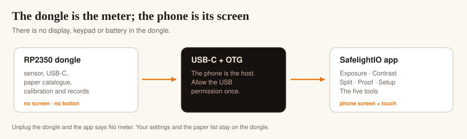

## 1.2 The one thing that makes it accurate

A light reading on its own is not a printing time. The meter needs to know what
your paper and developer do with that light. The **paper calibration** is the
bridge: one test strip gives the dongle two numbers, and it multiplies them
to get the paper's constant.

After that, the answer is just multiplication. The dongle does it; the app shows
it. The phone never does the metering arithmetic and never needs a network
connection.

## 1.3 What you need

- An Android phone with USB-C and USB host (OTG) support.
- The SafelightIO Android app installed on the phone.
- The SafelightIO dongle.
- A USB-C cable or a USB-C OTG adapter that passes data, not just power.
- Your paper, your filter brand and a test strip for the paper calibration.
- Optional: a computer and a USB cable for firmware updates.

> [!IMPORTANT] The cable matters
> Use a data cable. A charge-only cable can power the dongle but the app will
> never see it. If the phone offers a USB permission dialog, choose **Allow**.

## 1.4 Your first session

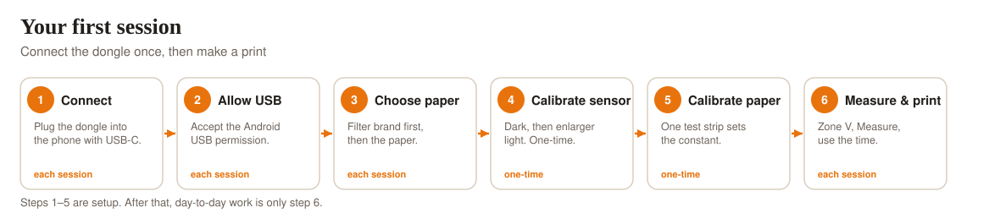

| Step | What you do | Where |
|---|---|---|
| 1 | Plug the dongle into the phone | USB-C |
| 2 | Allow the USB permission | Android dialog |
| 3 | Choose the filter brand and the paper | **Paper & filter** sheet |
| 4 | Calibrate the sensor: dark, then enlarger light | **Setup → Sensor → Sensor Calibration** |
| 5 | Calibrate the paper with one test strip | **Setup → Calibration** or **Tools & data → Estimate Calibration** |
| 6 | Measure the easel and print | **Exposure** |

Steps 4 and 5 are one-time jobs per device and paper. Step 3 is repeated when
you change paper. Step 6 is the everyday job.

### Step 1 — Connect the dongle

Plug the dongle into the phone. Android asks whether to allow the app to access
the USB device; choose **Allow**. The app's top bar moves from **No meter** to
**Linking**, then to **Ready · fw 0.11** (your firmware version may be newer).

If the app says **No meter** and no dialog appears, unplug the dongle, check that
the cable is a data cable, and plug it in again. On some phones the USB mode
must be set to **File transfer / MTP** or **USB controlled by this device**; the
app will show the permission dialog either way.

### Step 2 — Choose the paper and filter

Tap the selection bar under the top bar: it reads **No paper | No filter** until
something is chosen. The **Paper & filter** sheet opens.

1. Choose the **Filter brand** in the rail at the top.
2. Open the paper brand's row and choose the paper.

The sheet does not ask for a filter grade. The grade is chosen on **Exposure**
because it belongs to the exposure, not to the paper selection.

With no meter connected, the sheet says **Connect the meter to list papers**.
That is not an error: the list is on the dongle.

### Step 3 — Choose the zone

On **Exposure**, the zone rail is already at **Zone V**, the usual starting
point. Swipe the rail or tap a neighbouring zone to change it. The selected
value settles in the centre; the app shows **zone V** in the line under the
answer.

### Step 4 — Calibrate the sensor

Open **Setup → Sensor → Sensor Calibration**. Do **Calibrate Dark** with
the sensor covered, then **Calibrate Enlarger Light** with the enlarger on and
the sensor in the light. This is the sensor's zero and its reference; it is one
of the two calibrations that make the lux numbers trustworthy.

### Step 5 — Calibrate the paper

Open **Setup → Calibration** and enter the **Known lux** and **Known time**
from a test strip, or use **Setup → Tools & data → Estimate Calibration** to
estimate the pair. Follow the steps in chapter 10. The dongle stores the paper's
constant; the app reads it back on every connection.

### Step 6 — Measure and print

Return to **Exposure**. Put the sensor on the easel, tap **Measure**, and read
the time. Set the enlarger to that time, with the suggested filter grade, and
make the print.

> [!TIP] The first print is a starting point
> The meter predicts; the strip confirms. If the print is consistently too light
> or too dark, check the paper calibration before changing the meter's answer.

## 1.5 The five tools at a glance

| Tool | What it answers | What you do |
|---|---|---|
| **Exposure** | One printing time for the easel reading | Choose a zone, Measure, use the time and grade |
| **Contrast** | A time and a suggested grade from a highlight and a shadow | Measure the dim spot, then the bright spot |
| **Split** | A soft time and a hard time for a two-filter print | Measure the same two spots; use the pair |
| **Proof** | A grid of the print, and optionally the enlarger's evenness | Scan the grid, tap cells, read the verdict |
| **Setup** | Device, calibration, sensor, files and help | Open the page you need |

Every tool starts with its answer at the top of the screen. If there is no
answer yet, the answer area says so and tells you which measurement is missing.

---

# 2. The app at a glance

## 2.1 The shell

Every tool uses the same shell:

- **Top bar:** the SafelightIO wordmark on the left and the meter state on the
  right. The state is **No meter**, **Linking**, **Ready · fw …** or a short
  error. Tap it to open **Setup → Meter**.
- **Selection bar:** the paper on the left and the filter brand on the right.
  Tap it to open **Paper & filter**. This is the only place the paper and brand
  are chosen.
- **Content:** the current tool. The answer, the controls and the reference cards
  live here.
- **Bottom navigation:** **Exposure**, **Contrast**, **Split**, **Proof** and
  **Setup**. The active item has a tonal capsule.

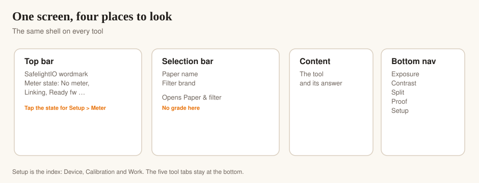

The app hides the Android status bar while it is in front. The page background
runs to the top of the screen, so there is no black strip above the interface.

## 2.2 The Paper & filter sheet

The sheet has two sections:

1. **Filter brand** at the top, as a horizontal rail. Choose the brand before
   the paper: the brand determines which paper rows and which grades are valid.
2. **Paper** below it, one collapsible row per manufacturer. The row shows the
   paper count; open it and choose the paper. The paper in force is marked
   **In use**.

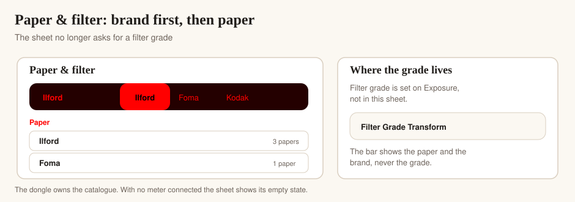

There is **no filter grade in this sheet**. The grade is a property of the
exposure and is chosen in **Filter Grade Transform** on the Exposure screen.
This is deliberate: a grade chosen while picking paper would be a second,
competing authority for the same number.

> [!NOTE] What the selection bar shows
> The bar shows the paper and the filter brand — for example
> **Ilford MGT Cooltone | Ilford**. It never shows a grade. If no brand is in
> force it reads **No filter**.

## 2.3 Setup is the index

Tap **Setup** in the bottom navigation. The index has three groups:

| Group | Pages |
|---|---|
| **Device** | **Meter**, **Paper & filter** |
| **Calibration** | **Calibration**, **Sensor** |
| **Work** | **Tools & data**, **Help & messages**, **About** |

The index is not a settings dump. Each row opens a page with one job. The
**Meter** page reports the connection and firmware; **Paper & filter** opens
the same sheet as the selection bar; **Calibration** is the paper's two
numbers; **Sensor** is gain, integration time, averaging and the Sensor Calibration card.

## 2.4 Connecting, reconnecting and the USB permission

The dongle is a USB device. The first connection raises Android's permission
dialog. After that, the app can reopen the port when the dongle is plugged in
again.

| Top bar says | Meaning |
|---|---|
| **No meter** | No dongle is attached, or Android has not granted access |
| **Linking** | The app is opening the port and waiting for `HELLO` |
| **Ready · fw 0.11** | The dongle answered; the app is reading its catalogue and settings |
| A short error | The port opened but the dongle did not answer, or the firmware refused |

If the state stays on **No meter**, open **Setup → Meter** and use **Reconnect**.
If that fails, unplug and replug the dongle. If the phone has a USB mode switch,
set it to allow the connected device.

> [!IMPORTANT] One app, one dongle
> Close any other app that is holding the USB port. Android gives the port to
> one app at a time. The SafelightIO app will show **No meter** if another app
> owns it.

## 2.5 What the dongle keeps and what the phone keeps

The dongle keeps the things that belong to the meter:

- the paper and filter catalogue;
- the paper calibrations;
- the filter brand and grade in force;
- the sensor gain, integration time and averaging;
- the per-paper trims and burn;
- the trims and burn the app writes back while you work.

The phone keeps:

- the app itself;
- the saved settings and session files in the Data Manager;
- the screen and the reader's current view.

The app is not a copy of the dongle. If you connect the same dongle to another
phone, the catalogue and calibrations are still there; the files on the old
phone are not.

---

# 3. Exposure

## 3.1 The screen

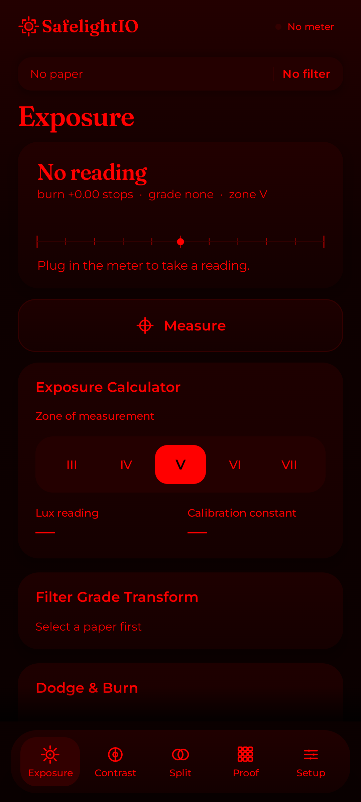

From top to bottom:

1. **No reading** (or the time) in the answer well. Under it, one line of
   conditions: **burn**, **grade**, **zone**.
2. A **zone rule** with a dot at the selected zone. It is a picture of where the
   reading sits on the 0–X scale, not a second control.
3. **Measure** — the one action. It is disabled when the dongle is not ready.
4. **Exposure Calculator** — the zone rail, the **Lux reading** and the
   **Calibration constant**.
5. **Filter Grade Transform** — the grade rail, or the reason there is no
   grade.
6. **Dodge & Burn** — the burn slider.

The answer well keeps the same height even when a long time shrinks to fit, or
when the conditions line wraps to two lines. The controls below do not jump.

## 3.2 Every control and readout

### Zone rail

**Zone of measurement** is a horizontal snap rail from **0** to **X**. The
selected zone sits in the centre; the neighbouring zones peek in at the edges.
Swipe the rail or tap a neighbour. The rail snaps to a whole zone, the dongle
saves it, and the app recomputes the answer from the stored reading.

### Lux reading

The illuminance the dongle measured, in lux. It is the number the time is
computed from. When no reading has been taken, it shows **—**.

### Calibration constant

The paper's constant, as the dongle holds it. It is the "known lux × known
time" product of the paper calibration, not a value you type here.

### Measure

One tap starts a `SENSOR` read, stores it as the exposure reading, and asks the
dongle to compute. While the dongle is working, the last answer stays on screen
and the button is disabled.

### Filter Grade Transform

The grade rail shows the grade tokens the dongle's table holds for the selected
paper and filter brand. A grade is a request, not a local choice: the app sends
`FILTER brand= grade=` and the meter answers. The line below the rail explains
the current state:

- **No filter grade — the time is the unfiltered one**;
- **No filtration — the time is the unfiltered one**;
- **Grade 2xM1 — the factor is the meter's**.

If there is no table for the paper and brand, the card says
**No grade table for this paper and filter brand** instead of drawing an empty
rail.

### Dodge & Burn

A symmetric slider: the lit span runs from the centre to the thumb, and the
default middle position has no fill. The value is in quarter stops. This is the
one trim on Exposure; the four trims live on Contrast and Split.

## 3.3 Step by step

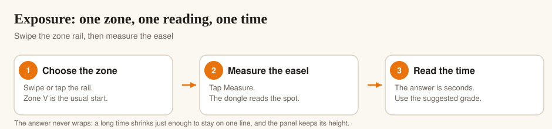

1. Confirm the top bar says **Ready**.
2. Choose the paper and filter brand from the selection bar.
3. Swipe the zone rail to the zone you are metering; **V** is the usual start.
4. Put the sensor on the easel and tap **Measure**.
5. Read the time. Set the enlarger and the filter grade; the grade is the
   suggested one in the answer line.
6. If the print needs a little more or less, use **Dodge & Burn** and measure
   again, or adjust the trim on Contrast.

## 3.4 The zone list

The rail runs 0 to X because those are the meter's own numbers.

| Zone | What it represents |
|---|---|
| **0** | The black end: deep shadow with texture |
| **I–III** | The low values |
| **IV** | A darker midtone |
| **V** | Middle grey: the standard metering target |
| **VI** | A lighter midtone |
| **VII–IX** | The high values |
| **X** | The white end: a specular or paper-base highlight |

Meter the tone you want to print as middle grey. If you meter a highlight, the
time will make that highlight middle grey, which is usually not what you want.

## 3.5 What the filter grade does

A variable-contrast filter changes the paper's speed as well as its contrast.
The dongle knows the factor for each grade in its table, so the time already
includes the filter. You do not multiply by a filter factor yourself.

The grade is independent of the zone. The zone chooses which tone becomes
middle grey; the grade chooses the contrast. Changing one does not silently
change the other.

## 3.6 Dodge and burn

The burn slider is a **bias**: it shifts the whole exposure, not a local dodge.
It is measured in quarter stops and is symmetric around zero. Use it when the
print is consistently a little light or dark but the contrast is right.

The four trims on Contrast and Split are the per-print adjustments: exposure,
contrast, highlights and shadows. They are saved per paper and per tool.

## 3.7 A worked example

Suppose the meter says **12.40 s**, **grade 2xM1**, **zone V**. Set the enlarger
to 12.4 seconds and the filter to the 2xM1 grade. Make the print.

If the print is slightly light across the whole image, open **Dodge & Burn** and
move one step toward **+** (a quarter stop). If the contrast is right but the
highlights are blocked, use the **Highlights** trim on Contrast instead. The
trim is the more surgical control; the burn is the global one.

## 3.8 Common questions

**The time is blank.** The dongle has not answered a compute yet. Measure, or
check that the paper has a calibration.

**The time says calibrate.** The paper has no calibration constant. Calibrate
the paper (chapter 10).

**The grade rail is missing.** The paper and brand have no grade table; the
card says so. Try another brand, or edit the paper in the Paper & Filter Editor.

**The app says No meter.** Check the cable and the Android USB permission; open
**Setup → Meter → Reconnect**.

---

# 4. Contrast

## 4.1 What the two readings mean

Contrast uses two readings:

- the **highlight**: the dim spot under the enlarger, where you want detail in
  the print;
- the **shadow**: the bright spot, where you want the dark areas to separate.

The dongle compares them and answers with a time and a suggested grade. The two
readings are stored on the dongle; changing paper or grade asks the dongle to
re-price the same two readings, so you do not have to go back to the easel.

## 4.2 The screen

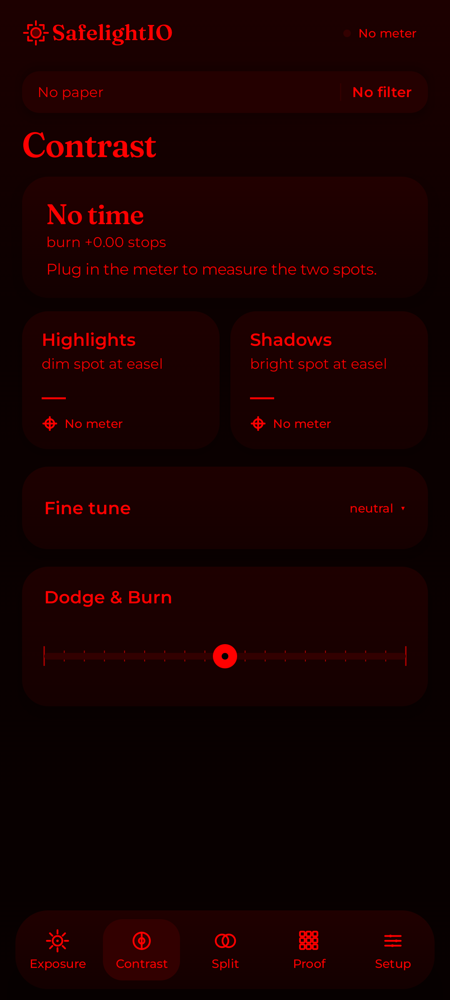

- **Time** and **Grade** share the answer well. Both values use the same font
  size; if one has to shrink to fit, the other shrinks with it.
- **Highlights** and **Shadows** are capture tiles. Each shows the physical
  hint, the lux and its **Measure** action.
- **Fine tune** holds the four trims and the burn. It is collapsed until you
  open it.
- **Dodge & Burn** is the same symmetric burn slider as Exposure.

The line under the two values carries the midpoint lux, the range, the grade
label, the match and the burn. It is limited to two lines; if it would need a
third, it shrinks just enough instead of pushing the rest of the screen down.

## 4.3 Step by step

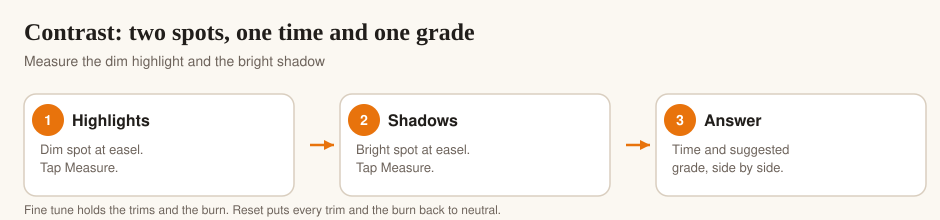

1. Confirm the paper and filter brand.
2. Tap **Measure** on **Highlights** and meter the dim spot.
3. Tap **Measure** on **Shadows** and meter the bright spot.
4. Read **Time** and **Grade** in the answer well.
5. Open **Fine tune** if the print needs adjustment; use the trims for
   highlights, shadows, exposure and contrast, and the burn for a global shift.
6. **Reset** puts every trim and the burn back to neutral. It does not clear
   the two readings.

## 4.4 How the recommendation works, without the maths

The dongle turns the two lux values into a density range, compares that range
with the paper's response and chooses the grade whose contrast fits. The time is
the exposure that places the highlight and shadow where the paper can hold
them. You do not need the formula; you need the two readings and a calibrated
paper.

## 4.5 Fixed-grade papers

A fixed-grade paper has no variable-contrast ladder. The grade rail shows the
paper's fixed grade, and **Contrast** still gives a time from the two readings.
Changing to another grade is not offered because the paper cannot use one.

## 4.6 A worked example

Meter the brightest area you want to keep detail in as **Highlights**; meter the
darkest area you want to keep separation in as **Shadows**. The answer might be
**8.4 s** at **grade 2xM1**. Set the enlarger to 8.4 seconds and the filter to
2xM1.

If the print is too contrasty, move the **Contrast** trim toward **−** in
**Fine tune**. If the highlights are too bright, move **Highlights** toward
**−**. The trims are per paper and per tool, so they survive a session change.

## 4.7 Common questions

**The answer says No time.** At least one spot has no reading. The hints under
the tiles tell you which one is missing.

**The time did not change when I changed the paper.** The app re-asks the dongle
when the paper change is confirmed; if the dongle is not ready, the old answer
stays. Check the top bar and **Setup → Meter**.

**The values have different sizes.** They should not: the two columns share one
fitted size. If you see a difference, the app is not the current build.

---

# 5. Split Grade

## 5.1 The idea

A split-grade print uses two exposures through two filters: a **soft** leg for
the highlights and a **hard** leg for the shadows. The dongle measures the same
two spots as Contrast and answers with a soft time and a hard time.

## 5.2 The screen

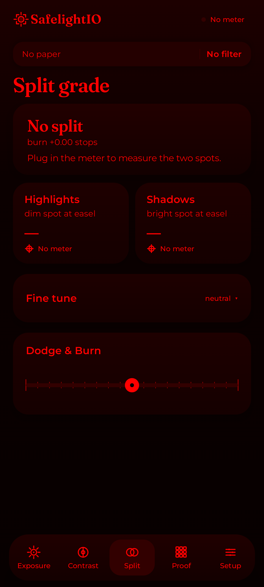

The answer well shows **Soft** and **Hard** side by side. The two values share a
font size, so the pair stays symmetrical. Under them are the conditions and the
midpoint.

The two capture tiles are the same highlight/shadow pair as Contrast.
**Fine tune** adds one control that Contrast does not have: the **Midtones**
pair. The pair is the meter's own soft/hard ladder position; **Reset** resets it
to the ladder's centre together with the four trims.

## 5.3 Step by step

1. Choose the paper and brand.
2. Meter the dim spot as **Highlights**.
3. Meter the bright spot as **Shadows**.
4. Read **Soft** and **Hard**.
5. Expose the print in two steps: the soft time through the soft filter, then
   the hard time through the hard filter. Cover the paper between the two.
6. If the print needs a different split, adjust **Midtones** in **Fine tune**;
   the dongle recalculates the pair from the stored readings.

## 5.4 How the split is chosen, without the maths

The dongle divides the tonal range between the two filters. The soft leg holds
the highlight and the hard leg builds the shadow. The **Midtones** control moves
the balance between the legs; it is not an exposure compensation and not a
contrast trim.

## 5.5 A worked example

The answer might be **Soft 5.2 s** and **Hard 3.1 s** at grade 2. Expose 5.2
seconds through the soft filter, then 3.1 seconds through the hard filter. If
the midtones are too heavy, move **Midtones** toward the hard side and make
another print; the dongle keeps the same two readings.

## 5.6 Common questions

**One time is missing.** The pair is computed only when both spots exist. The
hint under the missing tile says which spot to meter.

**Reset did not change the times.** Reset clears the trims and the Midtones
pair; the times are recomputed from the same two readings. If the paper has no
pair table, the Midtones row is inert.

**The two times look different in size.** They share one fitted size by design.
If they do not, update the app.

---

# 6. Virtual Proof

## 6.1 What it does

Virtual Proof turns a grid of easel readings into a picture of the print. In
normal (negative) mode, the cells show the meter's grayscale proof: where the
print will be light, where it will be dark, and which cells are clipped.

In **Enlarger Mode**, the same grid measures the enlarger's evenness: the cells
show deviation from the reference, and the answer is a uniformity verdict.

## 6.2 The screen

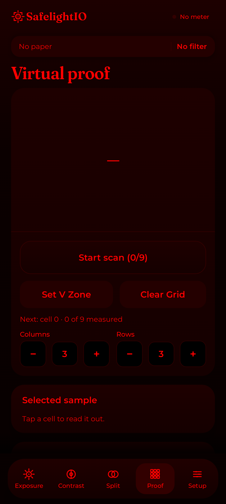

- The **cell canvas** is the main surface. The controls that move it are at the
  bottom of the same card: **Start scan**, **Set V Zone** (or **Set Reference**
  in Enlarger Mode), **Clear Grid**, the status line, and the **Columns** /
  **Rows** steppers.
- **Selected sample** shows the tapped cell's readouts.
- **Result** shows the measured count, range, mean, min, max and range fit. In
  normal mode it does **not** show Uniformity, Min/max spread or Worst cell;
  those belong to Enlarger Mode.
- **Filter grade** shows the proof grade rail. It is the grid's own grade, not
  the Exposure grade.
- **Histogram** is a disclosure card.
- **Settings** is a disclosure card below the histogram.

The explaining legend below the canvas is not permanent. It appears as a
dismissible banner only after a completed scan.

## 6.3 The grid frames

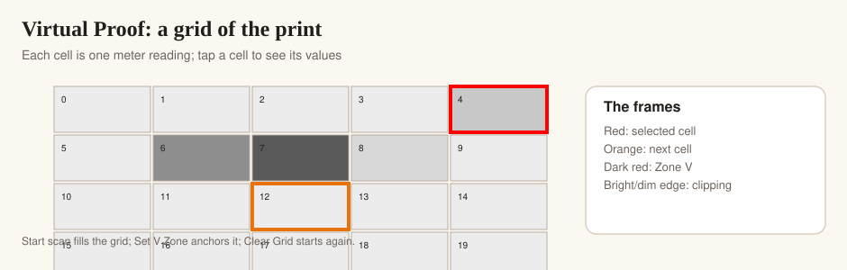

- **Red frame:** the selected cell; its values are in **Selected sample**.
- **Muted red / orange frame:** the next cell the scan will write.
- **Dark red frame:** the Zone V reference cell.
- **Bright or dim edge:** the cell is clipped at the highlight or shadow end.
- **Gray fill:** the meter's proof tone, 0 black to 255 white.

The legend is a reminder, not a second control list. The same information is in
this chapter.

## 6.4 A proof in ten steps

1. Choose the paper and filter brand.
2. Open **Proof**.
3. Set **Columns** and **Rows**; 3 × 3 is a good first proof.
4. Tap **Start scan**. The dongle measures each cell in turn.
5. If you scan by hand, move the sensor to the next cell and tap the action
   again. The app names the next cell.
6. Let the scan complete. The legend banner appears; read it once, then close
   it if you do not need it.
7. Tap a cell to inspect its **Selected sample**.
8. Read **Result** for the measured count and range.
9. Use **Histogram** if you want the distribution; it is above **Settings**.
10. Use **Settings** for Stability Detection, tolerance and the settle gate.

**Stop** appears while a scan is running. **Clear Grid** starts a new proof; it
does not change the paper or the calibration.

> [!NOTE] Set V Zone
> **Set V Zone** takes the selected measured cell as the grid's reference. In
> Enlarger Mode the same button is called **Set Reference**. It is enabled only
> when the tapped cell can serve as the anchor.

## 6.5 Enlarger Mode

Turn on **Enlarger Mode** in the **Settings** card. The answer well appears at
the top with the uniformity verdict; the result rows include **Uniformity** and
**Worst cell**. Use the grid to find hot spots and falloff in the enlarger's
light.

When **Enlarger Mode** is off, the verdict is not shown; the canvas is the main
theme and the result stays a print result. This is deliberate: a uniformity
percentage is meaningless for a negative proof.

---

# 7. Setup

## 7.1 The index

Tap **Setup**. The index groups the pages by what they belong to:

| Group | Row | What it opens |
|---|---|---|
| **Device** | **Meter** | Connection, firmware, serial and board |
| **Device** | **Paper & filter** | The same sheet as the selection bar |
| **Calibration** | **Calibration** | The paper's known lux and known time |
| **Calibration** | **Sensor** | Gain, integration time, averaging and Sensor Calibration |
| **Work** | **Tools & data** | Paper editor, estimate and files |
| **Work** | **Help & messages** | What a refusal means and where to fix it |
| **Work** | **About** | Version and the data rule |

## 7.2 Meter

The **Meter** page reports what the dongle said when it connected: the firmware
version, the protocol, the board and the serial number. The **SafelightIO ID**
is shown as `SN: ...`, the chip's uppercase unique board ID, just as the
7-inch device shows it. Use it to tell two dongles apart. **Reconnect** asks the app
to open the port and send `HELLO` again.

Use it when the top bar is stuck on **No meter** or **Linking**, or after a
firmware update. If the dongle is not attached, the page says so; it cannot
invent a connection.

## 7.3 Calibration

The **Calibration** page is the paper's two numbers:

- **Known lux**: the light measured on the test strip;
- **Known time (s)**: the exposure that produced the chosen midtone.

The page shows the paper the dongle has in force, whether it has a calibration,
the meter's constant and the phone's copy when one exists. Enter the pair and
send it; the dongle stores it for that paper.

For a fixed-grade paper, the page still takes the pair; there is no grade
ladder to choose. Use the same midtone procedure.

## 7.4 Sensor

The **Sensor** page has three controls:

- **Gain** — a snap rail: **Auto**, **Low**, **Med**, **High**, **Max**.
- **Integration time (ms)** — a snap rail from 100 to 600 ms.
- **Averaging samples** — a number field, 1–16.

The page also shows:

- **Effective gain** — the rung the meter resolved, or the manual gain it is
  using;
- **A read may take** — the time budget for one reading;
- the provenance line — whether the settings came from the meter or the phone;
- the phone's backup copy, when one exists.

Auto is the normal choice; a manual rung is for a difficult subject or for checking the sensor's behaviour.

### Sensor Calibration

At the bottom of the Sensor page is the **Sensor Calibration** card. It holds
**Calibrate Dark** and **Calibrate Enlarger Light**, plus **Clear Dark** and
**Clear Light**. Do the dark calibration with the sensor covered and the light
calibration with the enlarger on. This is the one-time job that makes the lux
numbers trustworthy.

> [!IMPORTANT] Do not skip the sensor calibration
> A paper calibration on top of an uncalibrated sensor gives a time, but the lux
> numbers under it are not trustworthy. The sensor calibration is the foundation
> for the paper calibration, not an optional extra.

---

# 8. Tools & data

Open **Setup → Work → Tools & data**. It has three cards.

## 8.1 Paper & Filter Editor

The editor changes the paper's coefficients on the dongle. Choose the filter
and the paper; the editor shows the **Lengthening Factor**, the **ISO R Range**
and the **Base ISO P**. For a fixed-grade paper, the factor and ISO R fields are
inert and the fixed grade is shown instead; the Base ISO P is editable.

The editor is an advanced tool. If you only need to choose a paper that is
already in the catalogue, use **Paper & filter** instead.

## 8.2 Estimate Calibration

The estimate card gives a starting calibration when you do not have a test
strip. It uses the paper's ISO P and the reference paper to estimate the pair.
Treat the result as a starting point and confirm it with a real strip.

## 8.3 Data Manager

The Data Manager saves and loads two kinds of file on the phone:

- **Settings**: the dongle's persistent settings, including the paper
  catalogue and calibrations;
- **Session**: the current tool's readings, trims and selections.

A load always shows a preview and asks for confirmation before it writes
anything to the dongle. **Save** writes a text file to the phone; **Load** opens
one after the preview. The app never silently restores a file at launch.

---

# 9. Saving, loading and storage

## 9.1 What is saved automatically

The dongle persists the paper, the filter brand and grade, the paper
calibrations, the sensor settings, the trims and the burn. The app reads them
on every connection. You do not need to press Save to keep the ordinary
working state.

The app's own view is not a file. Switching tools, rotating the phone or
reopening the app does not lose the dongle's settings because they are on the
dongle.

## 9.2 Settings files

A **Settings** file is a backup of the dongle's persistent state. Use it when
you want a copy on the phone, or when you are moving to another dongle. The
file is a text document; the Data Manager preview shows what it contains before
you load it.

## 9.3 Session files

A **Session** file stores the current tool's readings, trims and selections. It
is useful when you want to come back to a print after a break, or when you want
to keep the two readings from a Contrast or Split session.

Loading a session restores the readings and the trims; it does not change the
paper calibration or the paper catalogue unless the file contains those groups.
The preview always says what will be written.

## 9.4 What is kept, and what is not

| Data | Lives on |
|---|---|
| Paper catalogue | Dongle |
| Paper calibration | Dongle (and in a Settings file when saved) |
| Filter brand and grade | Dongle |
| Sensor gain, integration, averaging | Dongle |
| Trims and burn | Dongle, per paper and per tool |
| Current readings | App session; not on the dongle after a power cycle |
| Settings and Session files | Phone documents, only when you save them |
| App version and code | Phone |

The dongle does not persist the current readings. If you unplug it, the readings
leave with the app's session; save a Session file if you need them later.

---

# 10. Calibrating a paper

## 10.1 Before you start

You need:

- a calibrated sensor (chapter 7.4);
- the paper and the filter brand you will print with;
- a test strip and the reference print you are matching;
- a way to measure the light on the strip.

The paper calibration is one-time per paper and filter. Redo it when you change
developer, toner, or the paper's response.

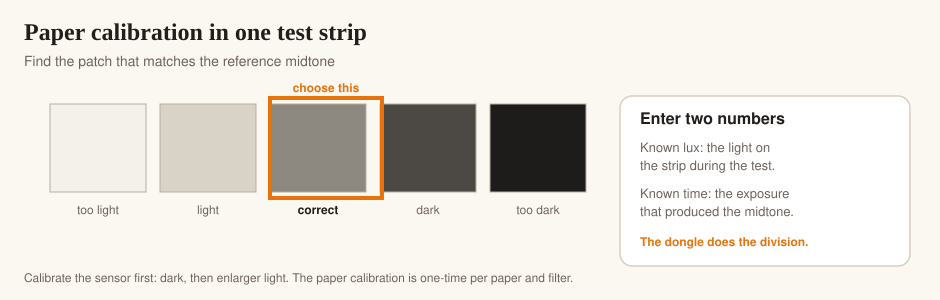

## 10.2 Procedure

1. Make a test strip with a series of exposures, usually in half or third
   stops.
2. Develop it exactly as you will develop the print.
3. Choose the patch that matches the reference midtone. This is the **known
   time**: the exposure that produced that patch.
4. Measure the light on that patch with the meter. This is the **known lux**.
5. Open **Setup → Calibration** (or **Tools & data → Estimate Calibration**).
6. Enter **Known lux** and **Known time (s)**; send the pair.
7. The dongle multiplies the known lux by the known time to get the paper's
constant. The app confirms
   the constant it read back.
8. Make a print at the meter's suggested time. The print should match the
   reference midtone; if it does not, check the sensor calibration before
   repeating the strip.

## 10.3 What "correct midtone" means

The correct patch is the one that matches the tone you want middle grey to be,
not the one that looks "nice" in isolation. Use the same reference print and
the same viewing light each time. A darkroom's safelight can make a print look
darker than it is; judge under the enlarger's white light or a consistent
viewing light.

## 10.4 Redoing a calibration

Redo the paper calibration when:

- you change developer or dilution;
- you change the paper's grade or the paper itself;
- the prints are consistently off in the same direction;
- you have replaced the sensor or the dongle.

You do not need to redo it for every print, every session, or every filter
change. The filter factor is part of the dongle's table, not the paper
calibration.

## 10.5 Fixed-grade papers

A fixed-grade paper has no variable-contrast ladder. The calibration pair is
still lux and time; the grade is fixed by the paper. The editor and the
calibration page show the fixed grade and make the factor/ISO R fields inert.

## 10.6 A calibration checklist

- Sensor dark calibration done.
- Sensor light calibration done with the enlarger at the working height.
- Paper and filter brand selected.
- Test strip developed exactly like the print.
- Midtone chosen under consistent light.
- Known lux and known time entered for the right paper.
- The dongle answered with a constant; the app shows it.
- A confirm print matches the reference.

## 10.7 Worked examples

### Example 1 — the first calibration

You expose a strip in one-stop steps and the 8-second patch matches your
reference midtone. You measure 1.20 lux on that patch. Enter **1.20** lux and
**8** seconds. The dongle stores the product; the Exposure answer for a 0.30 lux
reading is then about 32 seconds.

### Example 2 — a developer change

You change from a paper developer to a warmer, slower developer. The prints are
consistently light. Make a new strip with the new developer, choose the new
midtone patch, and enter the new pair. Do not compensate with the burn; the
burn is for a print that is consistently off for a different reason.

### Example 3 — a fixed-grade paper

The fixed-grade paper's calibration page still asks for known lux and known
time. Choose the patch that matches the reference; the fixed grade is already
part of the paper's response.

### Example 4 — no strip looks right

If no patch matches, check the sensor calibration first, then the developer
temperature and the paper's age. A paper calibration cannot repair a sensor
that is reading the wrong lux.

### Example 5 — a second paper from a reference

If you have a calibrated paper and want a starting point for another, use
**Estimate Calibration**, then make a strip to confirm. An estimate is a
starting point, not a calibration.

---

# 11. The paper and filter database

## 11.1 Where the catalogue lives

The paper catalogue is on the dongle. The app does not ship a copy. On every
connection the app reads the dongle's `PAPERS` block: the paper brands, the
paper types and the filter brands. That is why the sheet says **Connect the
meter to list papers** when no dongle is attached.

The catalogue includes the paper's filter system, its kind (variable or fixed
grade) and its filter table. The app uses those fields to decide which grades
are offered and whether the Midtones pair is available.

## 11.2 Filter brands

The **Filter brand** rail lists the brands the dongle knows. A brand is half of
the selection: `FILTER brand= grade=`. The brand is shown in the selection bar;
the grade is chosen on Exposure.

## 11.3 Adding your own paper

Open **Setup → Tools & data → Paper & Filter Editor**. Choose the paper and the
filter, then edit the coefficients:

- **Lengthening Factor**: the paper's speed factor;
- **ISO R Range**: the contrast range;
- **Base ISO P**: the paper's ISO speed.

For a fixed-grade paper, the factor and ISO R fields are inert; the Base ISO P
is editable. **Reset** restores the paper's defaults after a confirmation.

> [!NOTE] The dongle is the source of truth
> The editor writes to the dongle. Another phone will see the edited paper only
> after it reads the dongle's catalogue again. There is no cloud copy and no
> bundled fallback.

---

# 12. Filter factors

## 12.1 What a filter factor is

A filter factor is a multiplier on the exposure: a factor of 2 means one stop
more light. Variable-contrast filters have different factors at different
grades, which is why the grade and the time are linked in the dongle's table.

## 12.2 Measuring your own factor, simply

1. Meter a plain, even grey target without the filter and note the time.
2. Meter the same target with the filter and note the time.
3. Divide the filtered time by the unfiltered time. The result is the factor.

Do this at the grade you actually use. The filter's factor is not a constant
across all grades.

## 12.3 Re-measuring

Re-measure the factor when you change the filter brand, the paper, or the light
source. The dongle's table is the starting point; your own measurement is the
confirmation.

## 12.4 Long exposures

Very long exposures can lose contrast through reciprocity. The meter does not
invent a reciprocity correction; if your paper's data sheet gives one, apply it
as a deliberate exposure adjustment and note it in the session, not as a paper
calibration.

# 13. Messages and troubleshooting

## 13.1 The top bar

| What you see | What it means | What to do |
|---|---|---|
| **No meter** | No dongle, or Android has not granted access | Check the cable and the USB permission |
| **Linking** | The port is open; the app is waiting for `HELLO` | Wait a moment; then **Setup → Meter → Reconnect** |
| **Ready · fw …** | The dongle answered | Normal |
| **No reply** / a short error | The port opened but the dongle did not answer | Unplug, replug, reconnect |
| **Firmware too old** | The dongle cannot list papers | Update the firmware (chapter 14) |

## 13.2 The common refusals

The app quotes the dongle's own sentence. The words are the firmware's, not a
summary.

| Sentence | Meaning | Route |
|---|---|---|
| **select paper** | No paper is in force | Tap the selection bar and choose a paper |
| **calibrate** | The paper has no calibration | Calibrate the paper (chapter 10) |
| **no paper** | The dongle has no paper selected | Choose a paper |
| **no_data** | The paper and brand have no table row for that grade | Choose another grade or brand |
| **bad_arg** | A token the firmware does not accept | Check the value; use the in-app control |
| **measure the highlight and the shadow first** | Contrast/Split needs both readings | Measure both tiles |
| **select a measured cell** | Set V Zone has no valid selected cell | Tap a measured cell |
| **scan already running** | A proof scan is in progress | Wait or Stop |

The **Help & messages** page in the app explains the current sentence and the
route to the fix.

## 13.3 Troubleshooting

### The app never leaves No meter

- Use a data cable, not a charge-only cable.
- Accept the Android USB permission.
- Close any other app that holds the USB port.
- Try another USB-C port or OTG adapter.
- Open **Setup → Meter → Reconnect**.

### The top bar says Ready but there is no paper

- The dongle may have no paper selected; open **Paper & filter**.
- The catalogue read may still be in flight; wait a moment.
- Use **Setup → Meter** to see the firmware and the catalogue state.

### The times are consistently wrong

- Check the sensor calibration: dark and enlarger light.
- Check the paper calibration pair.
- Check that the paper in force is the paper on the easel.
- Check the filter brand and grade; a wrong brand gives a wrong factor.

### Contrast or Split says one spot is missing

- The hint under the tile names the missing spot.
- Meter it; the answer appears when both readings exist.
- A 0.00 lux reading is a real reading, not a missing one.

### The proof grid is empty

- The paper must be selected and the dongle ready.
- Start scan or measure the next cell; the canvas fills as readings arrive.
- If the scan stops early, the remaining cells stay empty; that is a valid
  partial proof.

### A firmware update fails

- Do not unplug until the `RP2350` drive disappears.
- If the update is interrupted, try the 1200-baud touch again.
- If the app no longer starts and the touch does not work, the unit needs a
  service recovery; a sealed unit has no BOOTSEL button. See chapter 14.

---

# 14. Firmware updates

## 14.1 Check your version

The top bar shows **Ready · fw 0.11** (or your version). **Setup → Meter** shows
the firmware, protocol, board and serial number. Write the version down before
an update.

## 14.2 Update with the 1200-baud touch

The dongle has no BOOTSEL button. Its USB serial stack supports the standard
Pico 1200-baud touch: opening the port at 1200 baud asks the running firmware to
reset into the RP2350 ROM bootloader. The ROM exposes the **RP2350** USB drive.

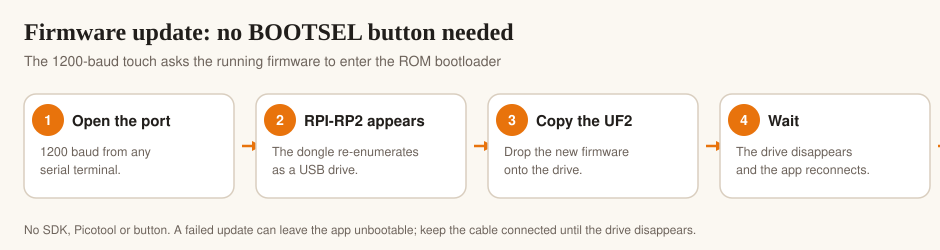

1. Save any Session file you need. The update does not change the paper
   catalogue or the calibrations, but a backup is cheap.
2. Plug the dongle into the computer with a data cable.
3. Open the dongle's serial port at **1200 baud** and close it.
   - macOS: `screen /dev/cu.usbmodem* 1200`, then quit.
   - Windows: a terminal program with the COM port set to 1200.
   - Linux: `stty -F /dev/ttyACM0 1200`, then close.
4. Wait for the **RP2350** drive to appear.
5. Copy the new `.uf2` onto that drive.
6. Wait until the drive disappears. Do not unplug during the copy.
7. Reconnect the dongle to the phone; the top bar should return to **Ready**
   with the new version.

No SDK or Picotool is required on the computer. The 1200-baud touch is a
feature of the firmware's USB serial stack, not a separate program.

> [!WARNING] No button, no easy recovery
> The 1200-baud touch only works while the current firmware runs. If an update
> is interrupted, the app may no longer start and the touch may not respond.
> The unit then needs a service recovery. Keep the cable connected until the
> `RP2350` drive disappears, and do not update on a low phone battery or a
> flaky hub.

## 14.3 What is kept

The firmware update replaces the program, not the paper catalogue or the
calibrations. The dongle's persistent records are kept. The phone's Settings
and Session files are not touched.

If the update includes a storage-format change, the release notes will say so;
read them before updating.

## 14.4 If the update does not start

- Check the cable is a data cable.
- Close the app on the phone; the phone and the computer cannot both own the
  port.
- Try another serial terminal; the port name changes each time the dongle
  reconnects.
- If the port opens but no `RP2350` appears, the firmware may not be running;
  see the warning above.

---

# 15. Reference

## 15.1 Ranges and defaults

| Control | Range | Default |
|---|---|---|
| Zone | 0–X | V |
| Filter grade | The paper/brand table | None |
| Burn | ±2.25 stops in ¼-stop steps | 0.00 |
| Contrast/Split trims | ±1.50 stops in ⅙-stop steps | 0.00 |
| Sensor gain | Auto, Low, Med, High, Max | Auto |
| Integration time | 100–600 ms | 200 ms |
| Averaging samples | 1–16 | 5 |
| Proof grid | 1–40 columns, 1–30 rows | 3 × 3 |
| Proof stability | On/off | From the dongle |
| Proof uniformity limit | 0.5–99.5% | 15% |

## 15.2 Glossary

**Calibration constant** — the paper's lux × time product; the number the meter
divides by the light reading.

**Contrast** — the tool that reads a highlight and a shadow and returns a time
and a grade.

**Dongle** — the USB meter: sensor, RP2350, catalogue and records. It has no
screen.

**Exposure** — the one-spot tool: choose a zone, measure, get a time.

**Filter brand** — the manufacturer of the variable-contrast filter; the brand
selects the grade table.

**Filter grade** — the contrast grade, such as 2xM1; chosen on Exposure, stored
on the dongle.

**Fine tune** — the collapsed Contrast/Split card holding the four trims and the
burn.

**Paper calibration** — the one-time test-strip pair that gives the paper its
constant.

**Proof** — the grid tool that previews the print, or in Enlarger Mode checks
the light's evenness.

**Split** — the two-filter tool: a soft time and a hard time from the same two
spots.

**Trim** — a per-paper, per-tool adjustment to exposure, contrast, highlights
or shadows.

## 15.3 Index of controls

| Control | Where | What it does |
|---|---|---|
| **Exposure / Contrast / Split / Proof / Setup** | Bottom navigation | Switches tool |
| Paper and brand bar | Under the top bar | Opens **Paper & filter** |
| Meter state | Top right | Opens **Setup → Meter** |
| **Measure** | Exposure | One sensor reading and a compute |
| **Highlights / Shadows** | Contrast, Split | Capture the two spots |
| **Measure** in a capture tile | Contrast, Split | Measures that spot |
| **Fine tune** | Contrast, Split | Opens the trims and burn |
| **Reset** | Contrast, Split | Neutralises the trims (and the Midtones pair on Split) |
| **Dodge & Burn** | Exposure, Contrast, Split | Global quarter-stop burn |
| **Start scan / Stop** | Proof | Runs or stops the grid scan |
| **Set V Zone / Set Reference** | Proof | Anchors the selected cell |
| **Clear Grid** | Proof | Clears the grid |
| **Columns / Rows** | Proof | Grid size |
| **Filter brand** | Paper & filter | Chooses the brand rail |
| Paper brand row | Paper & filter | Opens the paper list |
| **Gain / Integration time** | Setup → Sensor | Sensor rails |
| **Averaging samples** | Setup → Sensor | Number of samples |
| **Known lux / Known time** | Setup → Calibration | Paper calibration pair |
| **Calibrate Dark / Calibrate Enlarger Light** | Setup → Sensor → Sensor Calibration | Sensor calibration |
| **Save / Load Settings / Session** | Tools & data → Data Manager | Phone files |
| **Reconnect** | Setup → Meter | Reopens the USB port |

## 15.4 One-page cheat sheet

1. **Connect:** dongle → phone; allow USB; wait for **Ready**.
2. **Choose:** selection bar → Filter brand, then paper.
3. **Exposure:** zone rail → V; **Measure**; use the time and grade.
4. **Contrast:** meter **Highlights**, then **Shadows**; use **Time** and
   **Grade**.
5. **Split:** the same two spots; use **Soft** and **Hard**; **Midtones** in
   **Fine tune**.
6. **Proof:** set the grid; **Start scan**; tap a cell; read **Result**.
7. **Calibrate:** sensor first, then paper; one test strip sets the constant.
8. **Update:** open the serial port at 1200; copy the UF2 to **RP2350**; wait.

> [!TIP] If in doubt
> The app's **Help & messages** page quotes the dongle's own refusal and the
> route to the fix. The **Setup → Meter** page is the first place to look when
> the connection is not **Ready**.
